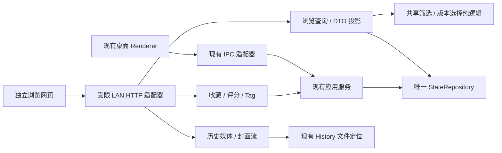

# LAN History Browser — 移动优先设计

- 类型：产品与技术设计；状态：accepted / implementing；当前实现与验收以 TASK 为准。
- 日期：2026-10-18；适用：同一局域网内的手机、iPad、桌面浏览器。
- 当前状态唯一入口：[TASK](TASK.md)；依据：[代码与外部调研](evidence/research.md)。
- 本文不替代当前 [Architecture](../../ARCHITECTURE_CONTRACT.md) 或 [UX](../../UX_CONTRACT.md) 契约。用户已提出的要求与本文建议默认值分别标识。

## 1. 产品定位与边界

一个从浏览器打开的个人历史视频库。按用户补充，GrokImage（Grok Imagine）也是原 App 最初的设计参考：本网页将它作为媒体陈列与视觉层级的主参考，小红书补充双列发现与筛选，TikTok 补充逐条沉浸观看。排序由用户控制，上下滑动浏览当前结果集。

用户最新澄清：以 Grok Image 的手机 App 体验为主线，弱化标题，把空间留给画面。先确立一套移动优先的媒体浏览和观看体验，再适配 iPad、PC 的可用空间与输入方式；不拆成两套独立设计。两端保持相同的视觉语言、信息层级、页面流程和核心操作，PC 只作大屏与鼠标/键盘适配。

用户明确要求：完整保留现有视频 Filter 与排序；瀑布流/相册模式；按可用宽度自适应列数，手机竖屏两列；全视口循环播放；中心单击暂停/继续；按住快进；周围单击显隐信息；上下滑动切视频；信息显示时左上角返回；收藏、评分与按按钮编辑 Tag。最新要求取消移动端日期 Slider；原始的全端保留要求据此收窄为桌面可选。

2026-10-18 用户补充：音量使用手机/iPad 自身按键，网页不提供音量滑条或区域音量手势。服务由 Settings 开关控制；开启后展示其他局域网设备可访问的网址，附“复制地址”和“在本机浏览器打开”按钮。

同日后续确认：服务生命周期跟随 App；移动端移除日期 Slider，方案覆盖手机和 iPad 触屏布局，不能仅因 iPad 横屏变宽就恢复轨道。最新指令：密码和配对留到最后，且可能取消；不作为浏览、播放、Settings 或 LAN 访问的实现与验收前置条件。

网页不包含创作工作台、队列管理、模型设置、复制文件/路径/Prompt、删除、改封面和继续生成等入口。收藏、评分、Tag 是明确允许的整理写入，因此服务是“浏览为主 + 三种受限写入”。第一版以视频为范围，图片浏览后续单独定义。

独立网页指独立入口、资源构建和浏览器客户端，不依赖 `window.studio`。正式服务可以由桌面 App 托管；“网页能单独测试”并不要求第一版实现独立守护进程。

## 2. 当前架构判断与复用边界

现状：

```text
Electron renderer → typed preload / IPC → application services → StateRepository / 文件
                                                  └────────→ ComfyUI（生成）
```

已完成的是进程权限和业务分层。`application-runtime.ts` 已不直接依赖 Electron globals，但当前组合、服务生命周期、事件桥接仍由 Electron 宿主管理。它尚不是现成的独立 HTTP 后端。

建议增量结构：



| 能力 | 已有依据 | 建议处理 |
| --- | --- | --- |
| Filter、排序、Tag 规范化 | `src/core/history-filter.ts` | 两个客户端共享语义；服务端执行筛选，不下发全部 AppState |
| 收藏/半星评分/Tag | `HistoryMetadataService`、`HistoryMetadataPatch` | 包装精简响应；保留桌面状态通知及串行持久化 |
| 媒体按资产/版本定位、Range | `HistoryQueryService`、`MediaReadService` | 提取可共享的文件流能力，新增严格限定 History 的 HTTP 路由 |
| 封面缓存 | `HistoryQueryService` | 直接复用现有磁盘图片和有效性判定，HTTP 返回缓存字节；仅 miss/stale 补生成 |
| 时间轴数据、排序时间 | `timeline.ts`、`historySortTimestamp` | 共用排序时间；日期轨道仅作为桌面候选，移动端不实现 |
| 播放器基础控件 | `media-chrome@4.19.2`、当前 `page.ts` | 优先验证已有依赖能否胜任极简壳；自建统一手势仲裁，不渲染音量调节控件 |
| 列表布局、详情外壳 | 当前 History renderer | 借鉴锚点/资源回收经验；新增适合触屏的 DOM 与布局策略 |

不能把整个 `AppApi` 自动映射为 HTTP。不能直接代理现有媒体 handler：它还服务 draft、queue、reference 和广泛 CORS，权限范围大于本网页。

## 3. 页面与视觉方向

### 3.1 首页

手机结构示意：

```text
┌───────────────────────────┐
│ 视频库  数量       筛选  视图 │
│ [仅收藏] [标签 ×]   最新优先 │
│ ┌──────────┐ ┌──────────┐ │
│ │          │ │          │ │
│ │   封面   │ │   封面   │ │
│ │      12s │ └──────────┘ │
│ └──────────┘ ┌──────────┐ │
│              │          │ │
│ ┌──────────┐ │          │ │
└───────────────────────────┘
```

紧凑 sticky 工具栏；不放占据首屏的大标题区。以 Grok Imagine 式媒体墙为主，列表默认不为每张卡片分配独立标题/说明行，缩略图直接构成主体；必要时只叠加时长及少量已有收藏/评分标记，不在封面堆 Tag 和生成参数。标题数据与可访问名称保留，打开观看后按需显示，不删除字段或改历史记录。触屏列表只加载封面，默认不批量自动播放预览。

视觉依据见 [逐屏参考与采用规则](evidence/visual-references.md)：已实际查看 Grok Imagine 三张官方演示封面、小红书三张官方屏幕、TikTok 平板横竖屏官方配图、PhotoPrism 三张官方界面，另外阅读 Pinterest、YouTube Shorts 和 Immich 的官方交互说明。推广截图只能证明所示布局，不证明当前所有设备版本的具体手势。

Grok Imagine 的采用重点：暗色低干扰底、紧密排列的不同尺寸媒体、低文字密度、主画面与辅助操作的清晰层级。当前官方桌面演示还包含项目侧栏、模板横带、无限画布和底部生成输入框，这些服务于创作，不移植到 LAN 浏览页。用户指定的手机两列、完整 Filter、评分/Tag 与逐条循环播放仍是本项目要求，不被参考产品当前布局替换；这次也不扩大成桌面 App 全面改版。

建议的手机起始规格：390px 视口左右各 10px、列间距 8px，约 181px 宽双列；顶部单行工具区约 52px，包含库标题/数量、排序、筛选和视图按钮。仅筛选生效时增加一行约 32px 的横向摘要，首屏不常驻完整 Filter；没有第二个页面目的地就不新增底部导航栏。具体尺寸为项目设计值，须通过截图和真实触控验证，不声称从参考 App 测得。

沿用当前 `src/styles/00-tokens.css` 的语义色、4px 间距体系、10/12px 控件/对象圆角和 Lucide 图标语言。建议默认深色，观看页黑底；普通列表使用平面层级和细分隔，信息覆层使用局部渐变确保可读。手机正文建议 14–16px，交互命中区域至少 44×44 CSS px；紧凑图标通过透明内边距扩大命中区域。

只抽取需要的共享 token，不加载包含 Create/Settings 的整套桌面样式。具体 token 提取和双端共享方式在实施时定，避免建立第二份手工主题事实来源。

### 3.2 移动优先的一套体验，适配 iPad 与 PC

先以 Grok Image 手机 App 的体验目标确定列表、观看与整理流程，再做空间和输入适配。下表描述同一套体验的延伸，不是两套产品设计，也不声称已实际验证 Grok 各端操作。PC 指独立网页在桌面浏览器中的界面，本任务不借此重做现有 Electron 工作台。

| 方面 | 手机优先基线 | iPad / PC 适配 |
| --- | --- | --- |
| 首要目标 | 画面优先、低信息密度、顺畅连续观看和轻量整理 | 保持同一目标，不因变宽切换成信息密集的管理界面 |
| 列表 | 手机竖屏瀑布流双列，相册四列/窄屏三列，无常驻卡片标题行 | 随可用宽度增加列数和媒体尺寸，延续相同卡片语言与打开方式 |
| Filter / 排序 | 顶部少量入口，完整 Filter 进入抽屉；摘要按需出现 | 保持相同入口、选项与操作顺序，抽屉/弹层尺寸适配，避免额外常驻面板挤压画面 |
| 观看 | 全视口舞台、边缘少量覆层、手势切换；收藏/评分/Tag 靠近拇指可达区域 | 同一观看模式随横竖屏与视频比例调整空间，保留相同核心操作，补鼠标和键盘切换能力 |
| 标题与信息 | 信息开启时仅一行低层级短标题和极少元数据，长标题按需展开；纯观看全部收起 | 保持相同弱化与显隐规则，不新增常驻大标题、详情侧栏或参数区 |
| 输入 | 点击和触摸均可操作；手机/iPad 无日期 Slider；设备自身按键调音量 | 鼠标/键盘补充同一操作，hover 只作增强，不成为必要入口；桌面日期导航仍仅为可选后续范围 |

布局既看可用宽度，也看主输入方式；iPad 横屏仍延续手机 App 的触屏体验，不因断点改成另一套流程。混合触控设备同时保留触摸与鼠标可操作性；响应式重排保持筛选、当前资产、播放状态和滚动锚点。

### 3.3 列数与媒体尺寸

以下是移动优先体验的媒体尺寸适配起点，不定义另一套 PC 产品。按 gallery 的 CSS 可用宽度计算，不按物理分辨率、设备型号或记录数量计算。横竖屏、分屏与浏览器缩放通过 ResizeObserver 自然重排。

| Gallery 可用宽度 | 建议列数 | 典型情况 |
| --- | --- | --- |
| < 280px | 1，窄视口恢复策略 | 极端分屏/放大 |
| 280–599px | 2 | 手机竖屏 |
| ≥ 600px | 约 230px 卡宽推导，至少 3、上限 8 | 平板横竖屏/桌面 |

上表仅作为瀑布流密度参考；相册采用更密的独立列数。用户最新明确：手机竖屏瀑布流两列，尺寸严格保持原始比例、不钳制超宽/超高比例；相册四列，窄屏三列。实现按媒体墙实际宽度计算：相册每列约 96px（含间距），上限 12 列；390px 手机为四列、320px 手机为三列。相册使用统一 3:4 框与对齐行，缩略图 `cover` 裁切填满、不留边；瀑布流 `contain` 完整呈现。两种模式切换入口一直保留，列数不因记录数量而缩减。观看视频始终完整显示，不随缩略图裁切规则改变。

iOS 底部 Home 手势条必须留操作安全区：进度条完整 44px 触摸目标位于 `env(safe-area-inset-bottom)` 上方，再留 18px 间距；横屏兼顾左右安全区。底部系统手势区不处理播放器点击、长按或上下切片；信息/操作浮层随同安全区上移。以 `viewport-fit=cover` 与动态安全区适配，不能仅写死某款 iPhone 的底部高度。[WebKit 官方说明](https://webkit.org/blog/7929/designing-websites-for-iphone-x/)

瀑布流数据序号始终来自同一筛选排序结果；视觉放置采用按顺序放入最短列的算法，键盘、读屏与播放器顺序保持数据顺序。大列表使用可计算坐标与虚拟窗口，避免 CSS columns 将视觉阅读顺序变成整列优先。预先保留封面比例；布局切换、旋转、关闭播放器时以 assetId + 视口偏移恢复位置。

### 3.4 完整 Filter 与移动端精简

| 当前视频能力 | 网页语义 |
| --- | --- |
| `favoriteOnly` | 仅收藏 |
| `minRating` / `maxRating` | 评分上下限，0.5–5，半星；未评分与低分不同 |
| `minDuration` | 最小时长，沿用当前单位与归一化 |
| `modelId` | 模型，选项来源于当前历史数据 |
| `tags` | 包含全部所选标签（AND） |
| `excludedTags` | 包含任意排除标签即排除 |
| `sort` | 最新/最早、评分高/低、时长长/短，六种 |

手机通过底部抽屉展开完整 Filter，平板/桌面可用侧抽屉；首页保留筛选摘要、清除单项及排序/布局快捷入口。抽屉编辑后点“应用”统一更新列表和计数，支持重置及取消。浏览器 URL 保存可分享的查询条件，设备本地保存视图偏好，不覆盖桌面草稿或桌面浏览状态。

时间排序继续使用 `updatedAt || createdAt`，同值按 ID 稳定排序。日期分桶采用服务端返回的宿主时区，避免手机时区与服务器分页、日期轨道不一致。

手机/iPad 不渲染日期 Slider、不预留 rail 宽度，也不增加日期定位浮钮或隐形拖动区域。日期仍可作为卡片/观看信息，六种排序与全部现有 Filter 保留；不因移除 Slider 偷加当前没有的日期筛选器。

桌面若保留原始要求中的日期导航，只在时间排序显示，不干扰评分/时长排序；它不作为移动网页首版的前置交付。日期分桶/跨页定位 API 可随桌面实现加入，不能为了移动端已经取消的控件先实现整套导航。

## 4. 全视口观看与返回

点击卡片进入浏览器内的观看路由，使用 `100dvh` 与 safe-area，默认不调用系统原生视频全屏。用户已确认：播放器占满可用视口，视频始终用 `object-fit: contain` 等比完整显示，不裁切、不拉伸；横视频在竖屏、竖视频在横屏均允许留黑。手机、iPad、PC 使用同一画面完整性规则，不再将裁切铺满列为待决策项。

进入时显示信息，轻触周围空白区域切换纯观看状态；纯观看隐藏标题、评分、Tag、返回与操作按钮。中心暂停区保持有效，暂停标记/缓冲提示/操作结果可短暂出现。隐藏后周围再点恢复信息与左上返回，系统/浏览器 Back 始终可返回。

用户实测后的交互补充：右上角开声/静音只显示图标，保留可访问名称；初次加载、缓冲和 seek 显示小型转圈。暂停图标约 2 秒自动淡出，点击周围空白可立即隐藏控件，中心点击仍能继续播放。列表向下滚动后右下出现返回顶部，尊重 reduced-motion；筛选里的布尔开关采用 iOS 圆轨滑块。

纵向滑动先让当前画面跟随手指，释放后约 240ms 进入相邻封面占位，再由同一个 video 加载新视频；未越过切换阈值回弹，首尾有阻尼，不创建多个活跃视频解码器。返回列表约 190ms 淡出/轻缩放，保留滚动位置。减弱动态效果偏好关闭这些位移过渡。进度条使用独立 44px 命中层捕获指针，视觉即时跟手，解码中的 seek 合并，释放精确提交并恢复拖动前的播放意图；不以焦点是否留在 slider 上决定是否更新进度。长按仅改变 playbackRate，释放不写 currentTime 或重载资源。

显示的信息控制在：一行低层级短标题、精简日期/时长、收藏、评分、Tag 和 i 按钮。评分星标与当前分数合并在同一个可点入口，展开紧凑悬浮窗完成半星选择、清除及保存；不额外显示第二个星标/分数入口。进度条区域透明，无渐变或色块背景，继续保留 iOS 安全区。i 信息窗按需展示只读 Prompt，保留换行、支持滚动和文本选择，使用纯文本渲染，提供空内容、失败重试和关闭。Tag 编辑复用 token 输入、建议与归一化；浮层打开时暂停，关闭后恢复打开前的播放状态；输入期间禁用视频切换快捷键和手势。

手机观看页左上单独返回、左下弱化短标题、右侧收藏/合并评分/Tag/i 信息入口，进度区域不加背景；不显示社交点赞数、评论、头像、分享和音乐转盘。iPad/PC 延续这套观看流程、核心操作和信息层级，按可用空间调整位置与命中区，并补鼠标/键盘支持，不另建 PC 详情系统。评分与 Tag 展开后才显示编辑内容。暂停/倍速图标按操作短暂出现，不常驻大播放按钮；用户指定的中心单击和周围显隐规则保留，不声称与参考 App 手势完全相同。

建议逐条循环，不播完自动换下一条；到结果集末尾上滑提示“已经是最后一个”，首尾不自动环绕。桌面提供可见上一条/下一条替代；Space 暂停，↑/↓ 切片，Esc 先关抽屉/显示信息，再返回；快捷键不捕获文本输入。

## 5. 播放序列与数据同步

打开观看时冻结当前查询的资产顺序与版本选择，保存 `queryId + assetId + versionId + index`，不是重新查询“所有视频”。一张卡片代表一项 HistoryAsset；使用现有 preferredVersion 规则，不能误用“复制文件时选择最高分辨率”的批处理 helper。应将复用的纯版本选择移至 `src/core/`，不让后端依赖 renderer。

首次可只分页返回 DTO，query snapshot 以有界、带过期时间的服务端 ID/版本索引保存；翻页和观看前后切换共用它，未来桌面日期定位也使用同一序列。收藏/评分/Tag 更新不使该序列立刻重排：例如在“仅收藏”里取消当前收藏，继续播放当前视频，返回首页时才重新计算列表。新输出只显示“有新内容，点此刷新”。

版本文件被桌面删除或移动时重新校验权限与可用性，显示“文件不可用”并允许下一条/返回，不复活旧记录。更新后的元数据立即同步当前卡片与桌面；返回时若原卡已不符合筛选，定位最近仍存在的邻居。snapshot 过期或服务重启时明确提示并以当前项重新建立查询，不能静默跳到无关视频。

收藏用明确 `true/false`，不用易重复翻转的 toggle 请求。元数据写入携带独立 curation revision 或 ETag：桌面/另一设备已改过时返回冲突并保留用户草稿，重新读取后重试。当前存储没有这个 revision，建议由唯一写入服务派生并统一覆盖 IPC/HTTP 路径，不拿不会随收藏变化的 `updatedAt` 冒充并发版本。

## 6. 手势仲裁

下列范围和阈值是原型起点，需真机校准。位置按播放器视口定义，横竖屏保持可预期，不按视频黑边动态改变含义。

| 手势 | 区域与建议结果 |
| --- | --- |
| 中心单击 | 中央约 44% 宽 × 40% 高；暂停/继续，短暂显示状态 |
| 周围单击 | 控件以外且不在中心暂停区；切换信息显隐 |
| 按住快进 | 非控件区静止约 350ms；临时 2×，显示“2×”；松开恢复原速和原播放状态 |
| 上下滑 | 位移先超过约 10px 后锁定方向；上滑下一条，下滑上一条；完成阈值建议 56px 或有明确速度意图 |
| 进度拖动 | 信息显示时的细进度条扩大命中区；独占手势，避免被识别为切片 |

同一个 pointer 只归一个动作。按钮/抽屉/进度条 > 已锁定倍速 > 方向滑动 > 单击。长按成立前位移超过阈值即取消长按计时并进入方向滑动，长按成立后不再切片。右侧不再保留特殊音量区域，与其余观看区域使用相同规则。暂停状态长按不强行开始播放。

采用 Pointer Events、pointer capture 与预先声明的区域 `touch-action`；不能等识别出长按后才改变 touch-action 并期待浏览器交还当前滚动。列表保持正常滚动；观看手势画布单独接管，表单/抽屉保持正常滚动和输入。不拦截浏览器边缘返回、多点操作或全局双指缩放。`pointercancel`、失焦、切片、返回、页面隐藏都清理计时器并恢复倍速。

所有设备均使用自身音量按键，网页不显示音量百分比或提供音量调节。若浏览器要求用户操作才能开声，保留静音/开启声音入口；它只切换静音，不调节音量。

## 7. HTTP 与宿主生命周期

已确认 Settings 提供“局域网视频浏览”开关。建议初始默认关闭；关闭时停止 HTTP 监听和媒体传输，已连接网页提示服务不可用；不退出桌面 App，不触碰生成队列与 ComfyUI。

分区位于“缓存管理”和“下载代理”之间。开关在左、端口在右，复用设置的两列布局；地址使用只读文本框，不使用下拉列表。多网卡逐行显示，每个地址的复制及本机浏览器打开按钮与文本框保持同一行；窄桌面宽度仍优先保留可读地址，不拆成单独操作行。

开启成功后显示运行状态、可供手机/iPad 输入的完整 LAN URL、“复制地址”和“在本机浏览器打开”按钮。本机打开按钮使用系统默认浏览器打开本机地址；显示给其他设备的 LAN URL 不使用 localhost。状态区区分“正在开启 / 已开启 / 开启失败 / 已关闭”，只有实际监听成功才显示已开启；复制/打开均有成功或失败反馈。端口被占用时显示原因并允许重试，不终止占用进程。

多网卡时列出可用 LAN 地址并允许选择/复制，避免将 VPN 或虚拟网卡地址当作唯一答案；断网、切换 Wi-Fi 或 IP 变化后刷新地址。界面不把“本机已监听”描述为“其他设备已连通”，防火墙和 Wi-Fi 隔离需要跨设备实际验证。建议记住用户的开关选择，重启时若选择开启则尝试启动；启动失败仍显示真实错误，不循环弹窗。持久化字段和恢复策略在实现时按现有 Settings 约定验证。

网页与 API/视频同源提供，依赖本地打包，无公网 CDN。服务只接触当前应用配置的历史库，不开放 ComfyUI、CDP、任意文件浏览或 shell 能力。

用户已确认服务跟随 App 生命周期：App 退出时停止服务，Settings 开关也可独立停止；关闭窗口/应用的现有生命周期不改为后台常驻。禁止另起进程与桌面同时直接读写同一个 JSON 文件。

以下三段仅保留为**可选最后阶段候选**，当前不实现配对页、密码、设备会话或设备管理，也不让这些能力阻塞 LAN 测试。若最终取消，浏览器直接进入列表；服务仍由 Settings 开关控制，未启用认证时不宣称内容已受密码保护。

如果最终采用数字配对：在 Settings 点击“配对新设备”，显示随机六位数字码及剩余有效时间；手机打开 LAN URL 后只见配对页，输入数字码成功再加载私有库。建议码 5 分钟有效、成功一次即失效、可手动刷新；这是一枚临时入场码，不是所有设备共用的长期固定密码。

网页采用一个支持粘贴、前导零和数字键盘的输入框，可在视觉上分成六格，不拆成六个互相抢焦点的字段。成功后给该浏览器独立、可撤销的随机会话，可记住设备；过期/清理浏览器数据/Settings 撤销后重新配对。电脑本机浏览器也经过配对，不能因 localhost 自动绕过。

短码配对接口需要全局与来源请求限速、失败冷却和配对窗口控制，避免只凭六位数字长期开放猜测；不记录明文码，不将码/会话加入复制网址、URL、访问日志或浏览器查询历史。Settings 提供“已配对设备”和撤销入口。建议会话使用 HttpOnly、SameSite cookie，HTTPS 时附 Secure；普通 LAN HTTP 模式仍不提供传输加密。具体会话有效期与重启恢复在实现前定稿，不将六位码当作持续访问凭证。

候选 API 草图（尚未发布，不是已存在的契约）：

| 方法/路径 | 返回/作用 |
| --- | --- |
| `GET /api/v1/library` | 服务能力、库 revision、宿主时区；不返回 Settings |
| `GET /api/v1/videos?...` | 校验 Filter 后创建查询快照，返回首批精简项、queryId、cursor、总数 |
| `GET /api/v1/queries/:id/items?cursor=...` | 同一排序下的后续页/相邻项，限制单页数量 |
| `GET /api/v1/videos/:assetId` | 标题、整理元数据、确定版本、尺寸/时长、可播放状态 |
| `GET /api/v1/videos/:assetId/versions/:versionId/cover` | 返回有效封面或可恢复的 pending 状态；认证若启用则统一校验 |
| `GET, HEAD /api/v1/videos/:assetId/versions/:versionId/media` | 仅该版本选定视频媒体，支持 Range |
| `PATCH /api/v1/videos/:assetId/metadata` | 仅 favorite/rating/tags，携带并发条件；返回精简更新项 |
| `GET /api/v1/facets` | 当前可选模型、Tag，与 Filter 语义一致 |

列表/详情 DTO 显式白名单：asset/version ID、标题、日期、时长、宽高、模型显示标识、整理元数据、同源资源 URL、媒体可用状态。按用户新增要求，点击 i 后单独 GET /api/v1/videos/:id/versions/:versionId/prompt，只返回 id/versionId/Prompt 文本，采用与桌面 History 相同的 LoRA 触发词规则；列表不预载 Prompt。该接口只读，不能编辑执行参数，不返回 workflow、文件定位、latent/run manifest、配置或完整 AppState。

当前先保持写入 Origin、内容类型、未知字段与长度/请求体限制，不复用 `Access-Control-Allow-Origin: *`；按 asset/version 解析文件并限定真实视频角色，不接受客户端绝对路径、任意 fileIndex 或草稿/队列资源。以上基础边界不依赖密码或配对。若最终加入认证，再将 API、封面和媒体 GET/Range 统一接入会话校验与 CSRF 保护，并补配对路由；不在前期先实现一套认证框架。

日期桶/跨页日期定位接口从移动端首版 API 列表移出，待桌面日期轨道实际纳入实施范围再定义。

第一版可信 LAN 可以采用 HTTP；配对不能替代传输加密，不将该模式描述为公共网络安全方案。不开放公网映射，不自动修改路由器或 Windows 防火墙。普通浏览/标注以 HTTP 能力为基线，不依赖 Service Worker、PWA 安装或其他安全上下文 API；HTTPS 与证书管理另作增强。

## 8. 视频、封面与性能

原文件优先直传并使用浏览器解码，不为浏览启动 ComfyUI 或 GPU 任务。Range、HEAD、Content-Type、Content-Length、206/416、客户端中断后的文件流释放、缓存失效均需明确测试；现有 Range 逻辑可提取并复用，但外网 HTTP 适配器必须重新验证。

现有封面已经持久化在 `userData/history-covers/v3`，不是只有 renderer 内存 Blob。现有流程为 `lookup → hit 直接读盘 / miss renderer 的 video+Canvas 取帧 → IPC 保存图片与 metadata → 后续读盘`。缓存以 key 摘要定位，并核对源文件大小/mtime；生成后的数据通过主进程落盘。需要区分“生产发生在 renderer”和“缓存由主进程管理”，二者都存在。

用户已明确队列所有权：卡片触发的封面工作一旦入队，由应用级后台队列负责完成。卡片滚出视口、进入详情/其他页面或 hover 清理只解除画面订阅、降低等待优先级；运行中的抽帧和保存继续，最新视口项优先处理等待队列，不反复取消重做。重新进入同一版本复用在途任务，初步预览之后仍完成最终选帧与落盘。源文件删除/替换及显式资源失效才中止旧任务并防止迟到结果复活。App 退出停止尚未完成的临时工作和解码器，已保存 JPEG/PNG 与 metadata 不删除；下次启动按原 v3 规则复用。后台队列不要求 App 退出后继续运行。

LAN 命中时直接使用同一份缓存文件与校验规则，只把桌面 `studio-media://cover/...` 资源改由按资产/版本解析的 HTTP 路由返回图片字节，保留相同源 revision/cache key；不重新抽帧，不复制一套缓存，也不要求先打开桌面 History。不能把缓存目录整体映射为静态目录；若最后启用认证，封面也执行同一访问校验，不能只保护列表。

缓存命中与 UI 显示加载必须区分。源定位只取 Settings，单资产读取只复制目标 HistoryAsset，避免每张图复制完整草稿/队列/历史状态。网页以最多 4 个短请求加载封面，缺图后台生成立即返回 pending、释放 HTTP 槽后有界重试；已有图不排在抽帧之后。浏览器保留最多 128 项/24 MiB 的封面 Blob（60 秒复验窗口），虚拟卡片卸载时回收其 object URL，重挂载优先复用；HTTP 封面支持 ETag 条件复验，磁盘 v3/source guard 规则保持不变。

只有 miss/stale（尚未生成、清过缓存、源文件变化等）才需要补生产。建议用宿主端可取消、低并发的补图任务写回同一缓存，避免手机为取一个封面下载/解码原视频；可复用现有 renderer producer 或增加 CPU 取帧适配，但需验证不改变当前选帧质量、评分/黑帧回避、source revision 和删除时防复活规则。不能为“搬到后端”默认引入不同选帧策略或先做全库重建。缺图时占位+有界重试不阻塞其他缓存命中项，视频仍可打开。具体 producer 选择在实现时按现有媒体工具/依赖核实。

原文件扩展名不等于目标设备可解码。首版返回正确 MIME，并通过浏览器真实 media error 展示文件/网络或不支持编码的恢复状态，保留封面、重试、返回/下一条；不提前保证全部历史媒体可播。当前自动样本为 H.264 MP4，真实音轨与设备编码另验。codec 预检、按需兼容副本及转码如有需要再定义资源调度；副本不得改变原 ID、源文件或 History 版本。

观看最多一个活跃解码器；相邻条目优先只预取元数据/封面，视频预载受限且可取消。切片停止旧资源，页面隐藏暂停，返回后按用户意图恢复。列表分页/虚拟化保留滚动锚点；快速滑动中不同时下载大量原视频。建议用 1,000 和 10,000 条元数据夹具测响应、DOM 数及内存；指标先实测基线，不把设计目标写成已达成性能。

## 9. 错误与恢复

| 状态 | 可见行为 |
| --- | --- |
| 未配对/会话撤销（仅可选认证启用后） | 配对入口，验证前不显示私有封面；前期无此页面 |
| 初次加载 | 固定比例 skeleton，避免跳动 |
| 库空/筛选无结果 | 区分“暂无历史视频”和“清除筛选” |
| 宿主离线/网络断开 | 当前画面保留、明确重连；未保存标注保留草稿，不假报保存成功 |
| 文件缺失/编码不支持 | 对应说明、重试、下一条、返回 |
| 保存失败/并发冲突 | 回滚错误乐观状态或保留表单；可重试，不中断当前视频 |
| 页面刷新/直接打开观看 URL | 重建浏览查询；找不到项时返回带原筛选的列表；认证若启用则先校验会话 |

手势均有可见按钮替代；控制区使用真实 button、slider 标签和焦点样式，隐藏信息不能留下不可见可聚焦按钮。评分可通过半星步进与键盘操作，Tag 抽屉关闭后回焦原按钮。尊重 reduced-motion，切片不强制大幅滑屏动画。

## 10. 实施与验收

1. **浏览器纵向原型**：按逐屏参考建立独立 Web 入口、隔离媒体/数据适配器，先实现两列/多列、两种布局、Filter 抽屉、观看/返回和手势状态机，直接进入列表。移动端没有日期导航。此阶段不读取真实用户库，不启动完整应用服务图；用真实媒体比例/长短标题/空错误状态，避免只用整齐占位图判断视觉。
2. **复用服务接通**：精简 DTO、分页/查询快照、受限媒体/封面路由、三种写入及跨端更新。通过窄宿主接口接现有服务，不扩充 main/application-runtime 为新的大路由文件。
3. **LAN 与真机收口**：桌面开关/地址发现/退出清理、网络恢复、Safari/Chrome、真实历史兼容性与大列表性能。完成后更新当前架构/UX/旅程契约与 Unreleased，交付预计 minor。
4. **可选最后阶段：密码/配对**：核心浏览体验和 LAN 功能完成后再决定是否保留。保留才实现认证、配对页、设备会话和撤销；取消则不新增相关功能。该阶段不反向阻塞前三阶段。

已按上述边界实现：`src/web/` 独立客户端，`src/core/lan-browser.ts` 与共享 History 规则，`electron/services/lan-browser-*` 受限适配，以及 `electron/lan-browser-host.ts` 的桌面生命周期。`npm.cmd run dev:web` 和 `build:web` 提供独立开发/构建入口；重复验收命令见 [产品旅程](../../runbooks/PRODUCT_JOURNEYS.md#lan-browser)。封面 miss 采用串行、可取消 CPU FFmpeg 写入同一 v3 缓存；缓存命中不启动生产器。查询最多保留 32 个快照，每个空闲 30 分钟过期，单页最多 96 条；列表只为视口附近创建图片节点，观看只保留一个 video 元素。

验收矩阵：

| 维度 | 必须证明 |
| --- | --- |
| 浏览器独立性 | 无 preload 时网页可启动；mock/隔离服务可测所有 UI 状态 |
| 移动布局 | 390×844 手机瀑布流两列/相册四列，320px 相册三列且填满无留边；横屏、iPad 约 820×1180 / 1180×820、分屏及桌面 1440×900 按真实可用宽度断言；进度条完整触摸目标避开底部 Home 安全区 |
| Filter/移动端简化 | 六种排序、包含 AND/排除 ANY、评分边界、清空与重置；手机/iPad 无日期轨道、无占宽/隐形命中区 |
| 播放上下文 | 列表点击真实卡片 → 正确 asset/version；上下滑沿筛选排序；收藏/评分/Tag 后不中途重排；返回恢复锚点 |
| 手势与输入 | 长按释放/取消与切片互斥、抽屉滚动、边缘返回、键盘、纯观看恢复返回；右侧无残留音量拦截区 |
| 跨端写入 | 网页保存 → 桌面更新 → App 重启仍在；并发冲突不静默覆盖；真实用户媒体用隔离副本 |
| HTTP/文件边界 | 任意路径/非视频辅助文件不可读；写入字段白名单、跨站拒绝；不依赖认证框架即可验证 |
| 数字配对（可选最后阶段） | 仅决定保留后验证：未配对 API/封面/Range 均拒绝，码过期/错误/限速/刷新/一次使用，记住设备及过期/撤销恢复配对 |
| 封面复用 | 预置有效缓存直接返回且不触发 producer；miss/stale 单任务补图并供双端复用；断开/删除不复活文件 |
| 真机媒体 | iPhone/iPad Safari 与 Android Chrome：循环、开声、暂停、倍速、旋转、设备按键调音量；桌面模拟不代替真机 |
| Settings 服务入口 | 开关实际启动/停止、复制 LAN URL、系统浏览器打开、本机/另一台设备均访问；端口占用、多网卡、地址变化及重启恢复 |
| 生命周期 | ComfyUI 离线仍可浏览；分享关闭/宿主退出停止监听并释放流；不影响生成队列/GPU |

涉及 History/共享状态/IPC 的代码执行 focused tests + `npm.cmd run verify`，真实 UI 证据与尚未覆盖的真机/大列表/编码范围统一记录于 [TASK](TASK.md)；不能将上表的目标当成全部已通过。
