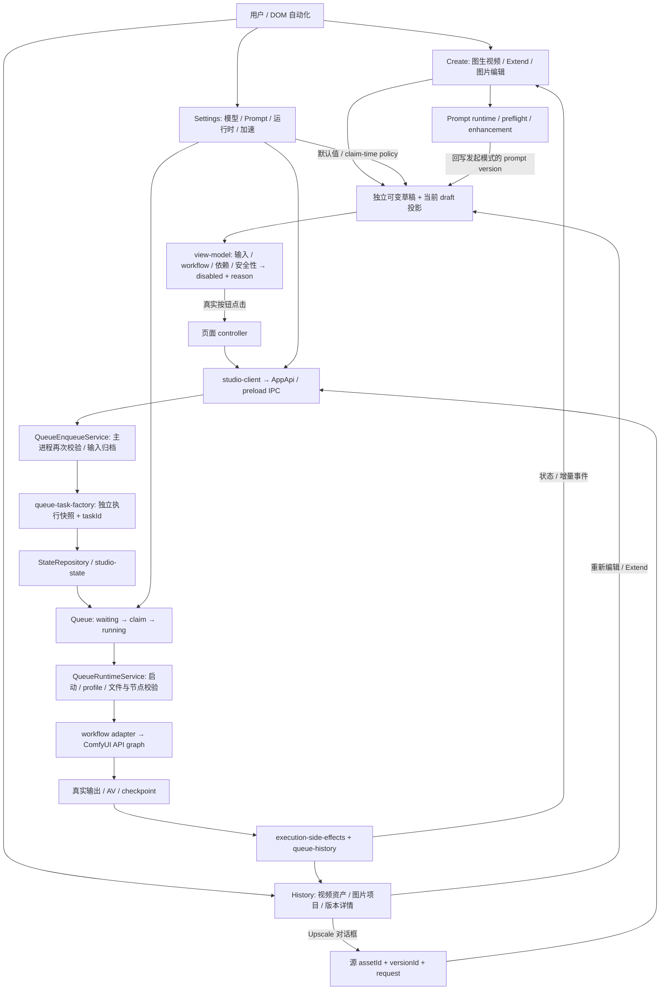
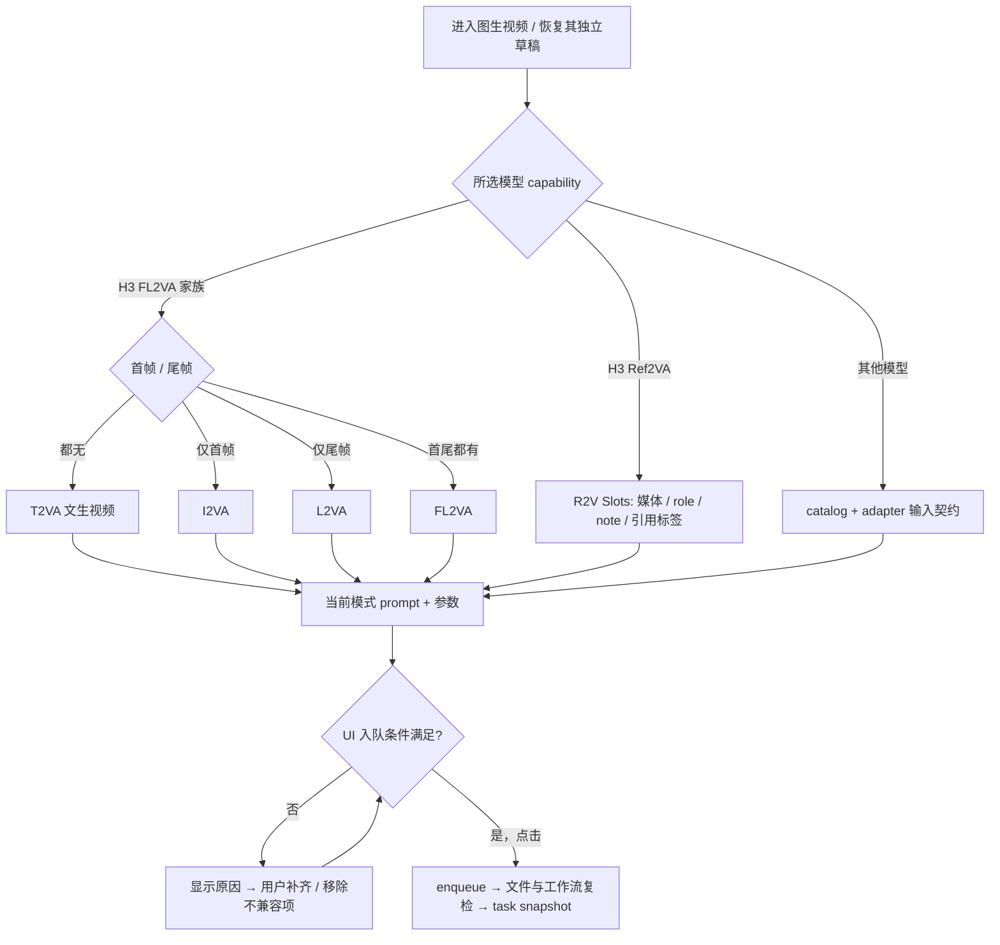
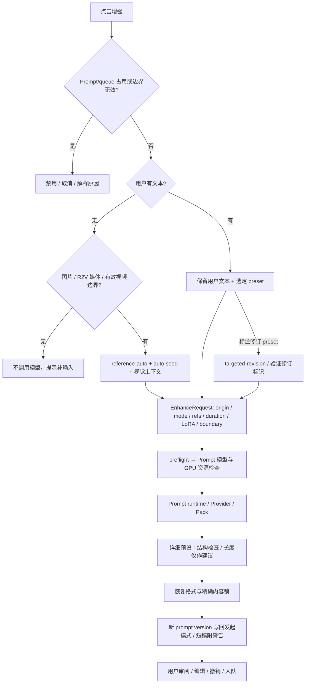
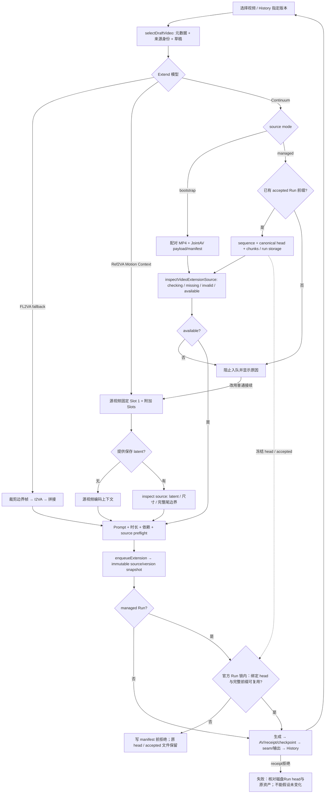
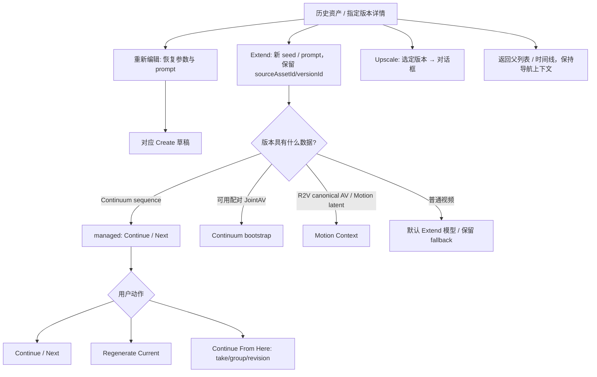
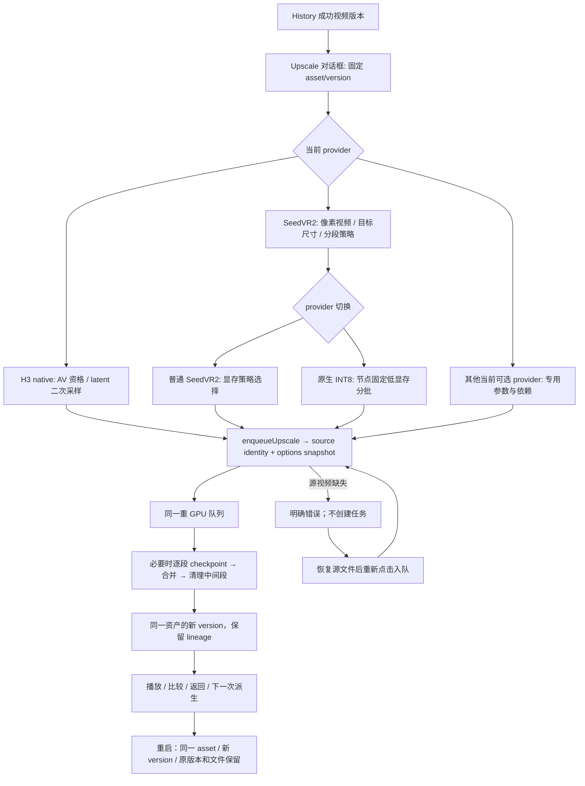
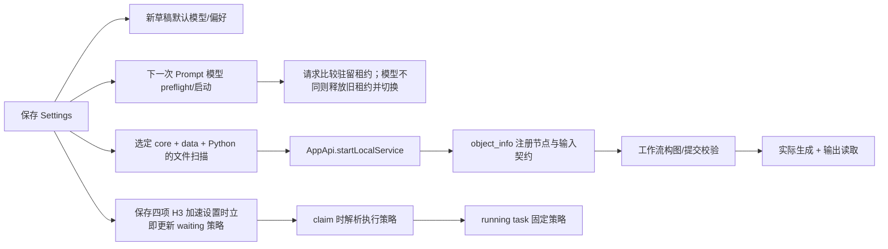

# 从用户操作到实现与验收

类型：架构与操作导航；状态：current；核对日期：2026-09-27。
范围：当前生产 renderer、AppApi、队列与模型路线。产品承诺仍由 [Architecture](../ARCHITECTURE_CONTRACT.md)、[UX](../UX_CONTRACT.md)、[Workflow](../WORKFLOW_CONTRACT.md) 定义；本页解释连接关系，不复制模型版本/文件清单。

先读总图，然后只读本次场景。用 `npm.cmd run harness:app -- list` 列场景，`npm.cmd run harness:app -- guide extend` 获取编辑入口、focused 命令和验收项。路由数据在 [journeys.mjs](../../scripts/harness/journeys.mjs)，路径存在性由测试检查。旧归档不再是理解 Extend 的首站。

## 总图：哪些层回答哪些问题

History 视频删除：普通确认 → 后端核对所选文件与最新引用 → 无引用直接删除／有引用列出关联对象二次确认 → 取消不删，明确确认后仅删所选目标；关联作品/草稿/队列保留，允许数据缺失并沿用 Extend 检查/回退。确认期间目标或关联变化须重新确认，不级联删除整个 Continuum Run。验收覆盖单条、版本、批量与辅助文件，见 [资产删除地图](ASSET_LIFECYCLE.md#4-用户能删除什么)。

外部浏览路线见 [LAN 浏览](#lan-browser)，不经过生成队列或 ComfyUI。



| 边界 | 负责什么 | 最小代码入口 |
| --- | --- | --- |
| 页面与刷新 | 路由、焦点、输入、播放；状态事件不能无故重建活动控件 | `src/renderer/entry.ts`、`render-coordinator.ts`、`pages/*/coordinator.ts` |
| 草稿 | `imageToVideoDraft`、`videoExtensionDraft`、`imageDraft`；`draft` 仅活动投影 | `src/core/creation-drafts.ts`、`video-draft-normalization.ts`、Create coordinator |
| 能力边界 | 页面用 capability，不读 preload global；Agent 可在真实 renderer 用 `window.studio` | `src/types.ts#AppApi`（符号）、`electron/preload.cts`、`src/renderer/studio-client.ts` |
| 提交 | UI 可提交只是第一关；主进程还验文件/graph/来源，随后复制快照 | `electron/queue-enqueue.ts`、`src/core/queue-task-factory.ts` |
| 执行 | 资源互斥、claim 时策略、取消/重启、输出收集 | `electron/queue-executor.ts`、`queue-worker.ts`、`services/queue-runtime-service.ts` |
| 持久化 | task / asset / version / run / AV 的身份与路径；重启迁移 | `electron/store.ts`、`queue-history.ts`、`services/queue-execution-side-effects.ts` |
| 模型事实 | capability、输入模式、文件、节点和 adapter | `src/core/catalog/`；禁止另写一份版本/权重清单 |

成功通常会将任务移出活动 queue；用 `version.taskId`（旧视频 original 可由 asset.taskId 回溯）查 History。不要等一个永远不会留在 queue 的 completed 项，也不要拿 `history.at(-1)` 当结果。

<a id="create-video"></a>
## 图生视频：选的是模型族，实际模式还由输入决定



- `h3PromptModeForDraft` 决定提示词模式；`h3WorkflowPathForInput` 决定执行工作流。两个都要核对。FL2VA 清空所有图可退到 T2VA；**R2V 空槽仍是 R2V 缺输入**，不能借此绕开校验。
- R2V 使用 Slots，而非首尾帧面板；图/视频、role、note、标签必须进入 prompt 请求及任务副本。增删/替换参考图也要测，不只测选模型。
- H3 FaceSwap：设置页手动补齐 UntMods 专用权重 → 普通 INT8 Ref2VA → 添加 FaceSwap 1.0 → Picture 1 参考脸 / Video 1 原片 → 缺脸/缺视频/多原视频可见阻塞 → 补齐后实际按钮入队 → 有序参考及 LoRA 冻结 → 原生 R2V 执行/History。触发词自动去重，提示词增强保留身份与表演来源分工；不自动选八步加速，不以旧续写入口代替原片编辑。权重/真实生成证据见 [FaceSwap TASK](../tasks/2026-10-20-face-swap-lora/TASK.md)。
- UI 阻塞由 `buildVideoCreatePageViewModel` / `videoEnqueueBlockReason` 投影到 `#enqueue.disabled`、`data-enqueue-block-reason` 和反馈文字；输入时 coordinator 的 `syncVideoEnqueueUi` 也要更新。单测某个 validator 不证明按钮会恢复。
- H3请求时长严格>15.1秒时，原时长标题旁显示三语言警告tooltip；15.1不显示。悬停/键盘展开和增量显隐保持输入焦点，警告本身不阻塞入队；缺输入、依赖与资源条件仍独立检查。
- 模型切换是异步的（获取 bundled workflow）；要测快速切换和返回另一 Create 模式，避免旧返回值覆盖新草稿。

| 用户选项 | 影响链 | 最小反例 |
| --- | --- | --- |
| 保存 AV | UI 新提交为 all/none；`h3-latent-save.ts` 保留旧 joint-av/motion-context 兼容；影响未来原生 Extend/Upscale 资格 | 关闭保存仍能普通生成；History 不得声称原生 AV 可用 |
| Spectrum | `video-policy` + 安装/运行节点 + snapshot → graph patch；不是全局开关 | 已选但节点缺失时给出原因；补齐后可入队；Motion Context 禁用 |
| LoRA / Turbo | 所选模型/输入模式/组合 → 步数和 sampler 契约 → 文件及 graph 校验 | 切模型遗留不兼容 LoRA；仅把步数改成 4 不等于 Turbo |
| 分辨率 / 时长 / ratio | native spatial/frame budget → UI 和 queue safety → adapter geometry | 极限值和切模型后归一化；不能只测试默认 5 秒 |
| FPS / 插帧 | 模型原生 FPS 与交付 FPS 分离；H3 有自身归一化策略 | UI 显示与最终 frame count 不一致 |
| H3 Create 1080p | 符合资格的 FL2VA Base + JointAV → 720p first pass → learned latent second sampling | 不是直接 1080p 采样，也不是 History Upscale；只最终结果进 History |

修改入口：Create `view-model.ts` / `page.ts` / `page-controller.ts` / `coordinator.ts` → `video-policy.ts` / `workflow.ts` → `queue-enqueue.ts` / `queue-task-factory.ts`。新增模型从 catalog capability 起步，别在多个页面复制模型 ID 分支。

<a id="prompt"></a>
## 提示词：上下文决定请求，运行时决定能否执行

- Strata uncensored：提示词设置为关闭／自带ESP／社区sergqwer三选一，保存／切页／重启保留；旧true迁移自带，其他后端不使用，不支持的Strata项禁用。当前请求冻结，下一次增强显式发送true／false；首次启用或向量身份切换重载但不重做大权重校验，关闭与同一已加载向量可保留模型。更新Strata时事务准备固定小文件，独立工具共用安装资产、独立保存选择。分别验证mode/hash、当次引擎对应作用层确认与完成日志；缺件／坏hash／错误身份不静默回退、不写回部分结果。源文件／协议模拟通过不等于实际IQ3图文效果通过。



- “有图片没文字”和“有用户指令”要分别抓取实际请求；前者 `promptStrategy=reference-auto`，后者不会静默替换成自动随机创意。请求正确不能证明生成文本忠实，真实样例另做语义检查。
- Strata首次增强：离线检查 → CPU校验/pack（现有提示与日志显示步骤/百分比，Strata PID可为空，不等同GPU加载）→ 健康的自有listener → 官方API Monitor只读窗口 → GPU加载/请求状态/详情/速度；临时密钥不进入renderer。网页首开失败按当前服务密钥最多3次、至少2秒间隔重试；关闭窗口不卸载且同一会话不反复弹出，停止模型/后端后关闭、下一次启动可重开。验证正常只读GET、错误/断线、取消/停止，以及恶意POST/配置/外连均被拒绝；监视流量不得创建新的推理或绕过队列互斥。
- Qwen MTMD 精简 logits 的修复不改变图片/输入/输出预算；用同权重同图对照原文、首token与decode，并确认旧视觉handler不受影响。共享 llama-cpp-python 升级须验证 Prompt Writer 的架构/诊断版本检查、Gemma实际增强与释放；不能只以导入成功代替两条真实按钮路径，不启用尚未验证的MTP。
- H3 模式按实际输入求得；普通 FL2VA/boundary/Continuum Extend 均是 I2VA 边界条件，不能因 UI 没首帧槽当作 T2VA；Motion Context 是 R2V。
- Extend 的 `extensionSource` 含视频与裁剪边界，服务负责提取视觉上下文。Continuum 不伪造 R2V reference 标签，还带 previous chunk 信息。
- Prompt 模型选择与生成模型选择独立。`promptModelId` 选择本地后端：现有模型路由 ComfyUI，Strata catalog ID 路由应用管理的独立服务；旧 LM Studio/runtime 字段不参与路由。27B 的显存确认/CPU 单次回退按原契约，Strata 不自动回退 CPU。首次 Strata 准备/加载也复用原方形停止按钮；扫描文件完整只开放选择，不写成运行验证通过。
- Strata UD-Q4_K_XL：模型卡四分片→共享模型命名目录→原版projector/MTP原地复用→固定hash与`--compat-bf16`离线pack/独立receipt→按Q4专家体量选择完整或显式预算驻留→原提示词按钮/独立Agent启动。缺片阻塞、补齐恢复、切换模型重新发现pack；H3仍32K，Agent长context计host KV。关闭/自带ESP/社区sergqwer三模式均可选，仍验证当次引擎作用层与逐请求应用，不把控制向量加载当去拒答效果。无权重阶段只验卡片/配置/合成按钮链，真实图文、Agent、性能与峰值留待实测。
- 异步回写使用请求的 `origin`；切换到图片编辑或 Extend 后，旧请求只能更新原草稿。失败不破坏原 prompt，取消不是错误成功。
- Strata完整H3增强统一调用一个编译器，不再按模式分流旧平铺模板：T2VA/I2VA/FL2VA/L2VA/R2V及三条Extend共用契约/控制/自动预算；仅参考角色、首尾对齐、续接时间轴有差异。批注仍为局部替换，图片编辑仍用自己的Pack。最终HTTP回归同时检查FL2VA双图顺序和所有路径思考/预算，不能用“参数写得一样”代替入口复用。
- Strata先以官方tokenizer核对完整输入、图片与所选thinking模板，再加载GPU；超限失败无新版本且不截断资料。提示词设置在uncensored旁提供思考强度关闭/低/中/高，默认中；官方high是xhigh别名，不伪造第五档。保存后下一增强/纠正请求快照生效，不改变正在运行的请求、准备身份或重载驻留模型；隐藏时保留，旧/损坏状态归一到中。开启仍用自动思考分配（reasoning_budget_tokens=0，官方answer_room预留正文），关闭显式enable_thinking=false并用非思考采样；两者仍用32K自动输出预算。思考不写回正文，实际计数更新进度，日志区分请求强度与实际思考量。图片/批注保留各自契约。Extend只用所选终点最后可见帧，不重复采样源视频；额外视频参考保留编号/静音采样。边界/Motion Context/Continuum分别保留I2VA/R2V/T2VA执行字段；当前独立Agent/其他后端不由本设置控制。按原按钮取消，请求正确不等于实际质量/延迟已验。
- Strata模型卡的MTP配套文件沿用组件信息弹窗和共享模型根手动下载；扫描不下载/哈希/加载。完整本地文件经固定hash→官方CPU转换→中文词表→原按钮加载；补齐MTP会使旧驻留下次请求重建，完整主pack不重准备。无MTP保留基础模式；明确允许官方文件回读时，完整驻留目标不足不单独阻止native IQ启动，仍检查启动RAM、commit和显存，并从本次引擎日志确认实际模式；可能降速。未允许回读仍拒绝，不把配置/mock通过当真实性能验收。
- Strata完整tokenizer预检→释放ComfyUI→按当前RAM/Windows提交余量/显存选择会话驻留策略→加载前复检→加载与推理低资源监测。资源不足/未知从原按钮明确失败且不写版本，不修改分页文件、不截断输入；充分资源可选完整arena，已驻留的暖请求不按剩余RAM重新选型或反复重载。会话配置不改变基础pack完成记录，停止删除自有会话文件。MTP解析器在软件安装阶段固定源码获取，增强时离线检查，不隐式联网补依赖。
- Strata host资源预警：native IQ允许文件回读时只沿用配置的6GiB RAM/commit启动预留，不以完整驻留或固定42GiB提交估计阻塞；RAM充足但commit不够arena仍可选resident。H3/Agent在所有阶段RAM<3GiB或commit<6GiB只记预警/恢复，不按单次低值/30秒缓存波动杀模型；仅新鲜完整样本连续10秒commit<512MiB才作host紧急停止，缺样/恢复/采样间隔>5秒重置。显存/遥测失效保护及Q4独立预算保留。验证40RAM/23commit加载、持续低RAM长流和同PID连续请求；合成低值不冒充硬件峰值证据。
- 此Strata分层详细扩写路径缺少原稿明确数字时间点时，仅允许一次保留完整上下文的有界思考纠正，每次仍检查32K/输出预算；再次失败不写回、不循环。时间数字存在不等于事件/角色/否定语义正确，仍需人工审阅。对白恢复限定主时间线，音场同句描述不抢占正文台词。
- 影视细节扩写的词数参考与有效正文短于原稿仅作警告，允许从实际增强按钮创建新版本、查看和编辑结果；简单画面不强制凑词数，也不因此自动补写。可见警告按返回正文计算，独立于 prompt 文本；重复填充、格式标签不增加覆盖长度。缺失、空或重复主时间线仍拒绝，不使用通用原稿关键词覆盖率拦截；结构/长度不代表语义完整或没有跑题。精确对白/可见文字处理、明确数字时间点检查、截断、资源及后端时长限制保持各自原范围，真正失败仍无新版本；精简和批注修订不套用详细扩写长度参考。

入口：`prompt-controller.ts` / `helpers.ts` → `src/core/prompts/` → `electron/services/prompt-application-service.ts` / `prompt-runtime-manager.ts` / `prompt-extension-media.ts`。不要只改 Pack 文本而漏掉请求字段或 runtime。

<a id="extend"></a>
## Extend：三条路线与 Continuum 内部分支



| 路线 | UI / 输入 | 关键限制与验收 |
| --- | --- | --- |
| FL2VA 边界续接 | 视频、trim、prompt；保留 fallback | 新标准任务新增段至30秒，完整预算736帧，旧快照按原policy；抽取准确边界，不宣称有运动 latent 连续性 |
| Motion Context | 源 Slot 1 不可删除/改类型，额外图片/视频 Slots；独立 latent 面板 | 新标准任务新增段至30秒，含上下文实际预算770帧；Spectrum 关闭；无 latent 可以视频上下文；有 latent 必须来源检查，结束 trim 对齐源尾部 |
| Continuum bootstrap | 配对 AV 文件与状态面板；使用整个源尾边界 | 文件名非空不代表可用；payload/manifest/几何等预检失败须阻塞且可恢复 |
| Continuum managed | 已接受序列/chunk/依赖状态；延续或重生成当前片段 | 必须有 acceptedChunks > 0；没有前缀不能新建 Run 冒充续写。另需原始首帧来源、当前 canonical head 与 run 文件一致；timeline prompt、强制 AV 保存和 duration 按生产校验 |

模式由 `h3ContinuumModeForSource` 判定：已有 accepted chunks 优先 managed；显式 bootstrap 或配对 artifact 走 bootstrap；否则根据 managed 标记/工作流。不是单凭“选了 Continuum”就能知道执行路线。

H3 Extend警告按新增段请求时长严格>15.1秒触发，不按来源、拼接总长或完整采样帧数。长来源加短片段仍不显示；warning不替代来源检查或阻塞提交。新Continuum草稿可至30秒，旧managed Run沿用冻结chunkSeconds；实际长时输出与末段质量另验。

**路由不等于入队资格**。`history-artifact-service.ts` 的 `inspectExtensionSource` 会阻止无 sequence 或 acceptedChunks=0 的 managed 输入。不能因任务工厂/旧队列分支能构造空 sequence，就宣称普通用户能新建 managed Run；不要添加模式开关或绕过门槛来让测试变绿。bootstrap 输出的 canonical AV 不会自动变成 accepted managed prefix。已有合成 receipt 的单测也不代表真实 run 已生成。

真实边界探针：从新的 `--asset-source-state` 隔离副本运行 `probe-managed-entry-smoke.mjs <fixture-dir> --port <port> --output <report.json>`。AppApi 仅准备无前缀的 managed 输入；缺视频→补视频仍因无前缀阻止→真实键盘改选 Motion Context→真实鼠标入队。报告的 task 是 **Motion Context**，没有 managed/GPU 成功结论。完整 managed 验收需要真实 accepted sequence、receipt、run 文件及原始来源的完整物理副本。新版检查实际 manifest v6/hash/resume_safe 与所选 head，旧 v5 Run 保留只读、不能直接作为 v6 前缀。独立 Native AV 仍走兼容模式。

2026-10-08当前环境正向证据：真实managed首段API夹具提供accepted=1，随后History实际Continue/空prompt恢复/鼠标入队与Queue Start完成1→2；8秒成片播放/重启、owner/alias/registry保护核对通过。该首段不是UI入口证明。新增前置保护后，真实按钮2→3产生12秒成片，receipt reused2/generated1/freshFallback=false；旧3段Run的Sol-Attn/Core VAE契约不兼容在写manifest前被拒绝，原head和文件不变。`comfy-ui.ts`把冻结前缀/head附在下游receipt；`managed_prefix_guard.py`定位实际注册的官方sampler命名空间，在其Run锁内拦截只读前缀检查，不改变采样节点/身份或放宽hash。保护只覆盖该前置拒绝，不承诺任意后续失败/崩溃自动回滚。正向审计见 `managed-history-audit.mjs` 和同一TASK最新增量。

入队前检查至少包括：真实视频与有效时长、trim、prompt、支持 extension 的工作流、frame/geometry 安全性、相关节点、所有参考槽、source inspection。inspect 依赖包括视频/latent/AV 路径、来源 version 和目标 geometry；修改源或分辨率后旧 available 结果必须失效。异步旧检查不得解除新草稿的阻塞。

入口：Create coordinator 的 `selectDraftVideo` / `refreshExtensionSource` → `video-extension-controller.ts` → `history-artifact-service.ts` 来源资格及 `extension-media.ts` / `h3-continuum-asset-registry.ts` → `queue-enqueue.ts` → `workflow.ts` / `h3-av-*` / executor。

<a id="history"></a>
## History 是下一条流程的起点



- `editHistoryAsset` 与 `continueHistoryVersion` 是不同动作：前者恢复编辑信息，后者建立新的延续输入；不要共享“复制所有字段”的捷径。
- R2V 原生 AV 的资格优先按其真实 source 类型判定；不要把所有 `.safetensors` 都送进 Continuum。
- Continuum 的“从这里继续”保留指定 canonical head/take 来源；“重生成当前”不是追加下一片段。验收需 A→B→C、从旧版本分支、失败/重试、重启后再次操作。
- 播放、封面、元数据与实际媒体路径是独立证据；标签更新不能重建播放器；文件缺失不能保留虚假的可续写资格。

入口：`pages/history/actions.ts` 决定回流参数；`actions-controller.ts` 绑定按钮；`navigation-controller.ts` 维护详情返回；`queue-history.ts` 和 side-effects 提交结果身份。邻接测试由 `guide history` 提供，播放与返回路径仍要实际 DOM 验证。

<a id="assets"></a>
## 资产保存、检查、转移与删除

见 [资产生命周期地图](ASSET_LIFECYCLE.md)：一条任务的媒体/参数/AV 保存清单、userData/输出/输入库/缓存分工、图片素材库检查与视频目录迁移的区别，以及共享引用/单版本/辅助删除边界。运行 `harness:app -- guide assets` 定位最小代码和测试；不要把 History 卡片、MP4、AV owner 当成同一个可删除对象。

<a id="upscale"></a>
## Upscale：结果驱动的独立任务



当前 provider 的可选性以 catalog、环境扫描和对话框为准；旧 DLSS5/AetherScale 持久化兼容代码存在不表示重新启用旧实验。不要从源文件数量推断产品入口。

H3 native 需要对应 AV/模型/尺寸资格；SeedVR2 的原生 INT8 分段路线先依据主机 RAM、目标像素和策略规划外层切段，再由 native 节点处理显存内部 chunks。恢复时复用已持久化计划和有效片段，不因空闲内存变化重切。对话框切换 provider 后检查 stale 字段、提交按钮与具体 `UpscaleRequest`。

入口：History `openUpscaleDialog` → `shell/secondary-dialogs.ts` / `upscale-controller.ts` → `src/core/upscale.ts` / `seedvr2-native.ts` → `queue-enqueue.ts` / executor / side-effects。

真实最小验收见 [Upscale 操作配方](../AGENT_ELECTRON_API_RUNBOOK.md#upscale-smoke)：原生 INT8 的 39 帧/480p→720p 已验证缺文件拒绝、恢复入队、GPU、派生版本播放及重启。UI 可见启用按钮不保证源文件此刻还存在，最终入队仍检查文件。这里只覆盖一次短片；普通 SeedVR2 为控件切换证据，H3 原生、其他 provider、长片分段中断恢复未实跑。后台窗口应在同一聚焦 CDP 会话中等待弹窗挂载，不在点击后立即断开并判断入口失效。

<a id="settings-runtime"></a>
## Settings：哪个时刻影响哪一层

缓存清理分支：设置→路径→刷新大小／清理缓存→现有typed cache IPC→浏览器／临时目录与受管理旧软件统一统计→安装互斥＋禁止模型交接的资源租约→重新核对当前安装、receipt、真实路径及用户数据→删除可重建旧软件→复扫、原进度与部分失败原因。活跃Agent/Strata跳过而不卸载；当前版本、共享模型、配置／媒体／会话与未知归属保留。隔离真实按钮验证必须隔离APPDATA／LOCALAPPDATA／TEMP与Comfy根，不能为了测试清理用户真实缓存；断言预期旧文件消失、保护文件和state不变，检查无新增任务／模型请求并收尾测试进程。

Strata更新下载恢复：用户点击更新→固定资产缓存/旧半包来源核对→按实际字节Range续传；断线只在有限预算内重试，取消保留半包且不再请求，具体错误进入原安装日志。再次点击跨新staging复用同一资产缓存；完成后仍按固定size/hash→解压→独立venv→发布记录。校验失败的包删除、不发布；失败恢复旧软件并清理新暂存，成功后清理旧软件、可核对历史暂存和下载包，始终保护共享模型。真实本地curl中断/续传、Range拒绝、取消与隔离安装事务分别记录，不把这些证据称为GitHub实际更新成功。

Strata版本分支：本机受信安装记录 / catalog推荐 / 官方release最新查询 → 共用节点版本行；当前旧版显示更新，未装显示安装，同推荐显示重装。实际下载只由用户点击触发；更新目标统一为`strata/runtime`，主应用和独立Agent共享解析，旧managed路径迁移但显式手动目录不切换；完成验证后旧软件清理，不长期并存版本。旧缓存仍绑定实际软件revision，不把提高推荐号当成运行已验证；最新查询失败显示未知，不用推荐值冒充。版本选择/隔离安装证据与真实引擎安装/推理证据分开报告。

Strata 卸载分支：应用管理安装 → 既有三角菜单“卸载” → 默认聚焦取消的应用确认弹窗 → typed `uninstallStrata` → 后台核对当前管理路径/安装记录/模型根隔离/操作忙碌 → 删除当前软件目录 → 日志/离线复扫 → 无三角的未安装卡片。取消不调用卸载；文件归属改变时拒绝并保留错误及复扫后的状态，用户可取消或恢复后重试。共享模型、独立数据与旧备份保留，不修改设置、queue/History、ComfyUI Python，不启动或重启 ComfyUI。手动目录仅保留原有打开位置功能，不授予删除权限。

安装取消分支：排队节点 → 主按钮“移出队列” → renderer 安装队列移除，验证该项没有安装 started 记录；执行中的节点/软件 → “取消安装” → typed `cancelDependencyInstall` → 当前安装事务信号 → 自有子进程树退出 → 恢复/日志 → 离线复扫/解除占用。等待项和生成队列不变；取消当前节点后下一项仍可继续，已成功项保留批次末尾重启。检查“正在取消…”禁用重复点击、不把取消显示为错误，取消后可重试。用隔离节点/软件目录验证，禁止中止用户或其他任务的进程；共享 Python 包的部分更改与目录事务恢复分开报告。

Strata 安装进度分支：实际点击安装 → 卡片内立即显示进度条 → typed 依赖日志事件携带当前阶段/实际下载字节 → 局部更新进度区域。下载显示百分比与大小，其余阶段动态条；百分比仅为下载，不估算整个安装。收起日志仍可见，切换页签保留步骤，不重挂输入/移动焦点；取消反馈优先，取消/失败收尾后隐藏。实际 UI 与本地真实 curl 字节采样分别验证，不冒充完整安装或推理证据。

节点/依赖（含 Strata）共用安装主按钮与三角菜单；未安装项不显示三角或位置操作。已安装项的“打开位置” → 既有 `showItemInFolder` → 只读核对实际目录/文件 → Explorer 定位。下拉菜单使用实色背景、单行短标签，收起时整体隐藏；未知位置不显示位置操作。自定义节点与 Strata 定位安装目录，llama-cpp-python 定位所选 Python 实际扫描出的 `llama_cpp` 包目录（不是解释器）；H3 加速依赖仍定位共享解释器环境。普通导入失败但包文件存在时仍可定位，旧扫描/未知包目录不回退 python.exe，卸载保留；已移动/删除或打开失败提示重新扫描。此动作不安装、不创建目录、不改 queue/History，不受 GPU 运行门槛影响；卸载仅保留原有可卸载项。

Strata 准备分支：节点与依赖 → 一键安装/重装 → typed `installStrata` → 固定软件/独立 venv → 安装日志 → 离线复扫。失败保留日志并恢复按钮，手动目录拒绝覆盖；模型卡 → 用户下载 → 大小/头检查。此分支不经过 Prompt lease、queue 或 GPU，不把软件安装当成推理可用。参数折叠，模型与所选 ComfyUI 共用模型根目录下的 `LLM/Qwen3.8-Flash-Next-GSQ-RCO-GGUF`，软件安装目录独立。同一共享根下旧 `LLM/strata` 文件仍原地兼容扫描，新目录优先，下载指引始终指向新目录。更换模型根/所选 ComfyUI 后旧扫描证据失效；首次未配置根时，下载指引可经现有扫描取得发现的共享路径。旧下载记录只在共享根未知时回退，不新增目录设置、不搬文件。模型卡客观描述模型与量化，状态单独显示。



| 设置/状态 | 生效时机 | 必查相邻行为 |
| --- | --- | --- |
| 默认视频/Extend/图片模型 | 新建/缺失模式草稿默认；已有模式快照需恢复 | 模式切换保留已有草稿，清空按当前策略；默认视频模型保存及合法草稿重启保护已有真实 Harness |
| Prompt 模型、Pack、auto seed | 下一次增强/启动读取保存的设置，受 runtime lease 与资源仲裁；当前 provider 固定为 ComfyUI | `request.modelId` 是生成模型；日志 `promptModelId`/`promptBackend` 才是提示词路由。旧 2B 已驻留时保存 4B 不立即卸载；下一次实际增强切换到 4B。Pack/auto seed 不因模型实跑获得验证 |
| H3 attention/sparse/runtime/compiler | 保存时立即更新 waiting H3 策略；claim 时解析，运行后保持 | Attention 已有 waiting 保存/重启及真实 running 保存/成片/重启证据；其他三项和 failed 排除仍是服务测试 |
| H3 视频 VAE | 按对应工作流的入队/执行策略解析 | 核对设置值与任务实际 VAE；不要套用上述四项加速设置的即时更新规则 |
| Spectrum/LoRA/保存 AV | Create 本次选择进入任务快照 | 设置或草稿更新不能改已入队选择；与 claim-time 例外区分 |
| ComfyUI/Python/model/output 路径 | 保存后所选实例扫描/运行时解析与历史兼容 | 离线多安装、在线实例一致、重启后旧输出定位 |

保存设置与启动恢复归一化是不同路径。构造 AppApi 测试草稿时必须满足当前模式约束：`video-policy.ts` 禁止 video 输入的 R2V 使用 Spectrum；`video-draft-normalization.ts` 在恢复时清理不合法值。6B-1 真实保存/重启使用合法输入并比较完整草稿，不通过忽略字段来掩盖差异。

Prompt 租约切换入口为 `prompt-application-service.ts` 的 `beginPromptRuntimeLease` / `releaseRuntime`；保存服务没有立即卸载旧模型。Queue 开始按钮在 `pages/queue/controller.ts`，claim 与 waiting 更新分别在 queue runtime service 和 H3 policy。History 恢复会由 `store.ts` 补旧内存字段，`history-query-service.ts.restoreHistoryFileSizes` 用实际 stat 填文件大小；重启审计按这两个明确规则比较，不能忽略任意对象差异。实际探针方法见 [设置探针表](../AGENT_ELECTRON_API_RUNBOOK.md#settings-probes)，覆盖状态只在 TASK 维护。

修改入口按层选择：Settings 表单/保存协调在 `src/renderer/pages/settings/`；保存及 waiting 策略更新在 `electron/services/settings-service.ts`，策略解析在 `src/core/h3-execution-policy.ts`；Prompt 请求由 `create/prompt-controller.ts` 组装，`prompt-application-service.ts` 读取保存设置，`src/core/prompt-models.ts` 定义后端，`prompt-runtime-manager.ts` 管理操作/驻留状态。不要把生成模型 ID 改成提示词后端 ID，也不要用一次 Attention UI 实跑推广四项设置均实跑。操作选择见 [设置探针表](../AGENT_ELECTRON_API_RUNBOOK.md#settings-probes)，本机验收范围由 TASK 维护。

Prompt 最小设置闭环见 [操作配方](../AGENT_ELECTRON_API_RUNBOOK.md#settings-prompt-smoke)：真实保存模型，缺文本/媒体时观察通知阻塞及零请求，补文本后真实增强追加版本。默认、--resident、--history 分别选择 waiting 保护、旧租约切换、单作品物理保护；H3 运行中设置用独立 running 探针。各自审计完整内容与重启，不能互相代替。已验收范围与未覆盖边界见[归档TASK覆盖矩阵](../archive/2026-09-27-agent-journeys/TASK.md#settings-coverage)，不在此复制第二份台账。

四个证据层必须分开：**文件存在 → 节点 schema → graph 可接受 → 实际输出**。Settings 离线扫描可用；runtime 尚未验证是中性，不等于安装缺失，也不是生成成功。ComfyUI 未启动时，运行任务要调用应用的 `startLocalService("comfy", settings)` 并等 ready，再扫 runtime；不能写“服务没开，无法验证”就收工。

本地单 runtime 启动会接管所配 listener，退出负责清理；remote connection-only。先确认资源归属。Prompt 与视频/图片/Upscale 共用重 GPU 仲裁；`prompt-resident` 与 queue profile 有转换，不能任意并行另启 Python。

<a id="image"></a>
## 图片编辑也经过同一闭环

独立 `imageDraft` → 模型 capability → Picture Slots / prompt / quality / 尺寸 → `enqueueImageEdit` → image task/runs → `imageHistory` project/version。文生图模型可无图；LaMa 必须 clean image + mask 且无 prompt；BiRefNet 无 prompt、透明 PNG；Paint guide 不能当二值 mask。不要把这些条件泛化到所有图片模型。

图片清空按钮 → 确认 → 只清内容/旧作品关联，不恢复默认模型或步数；生成参数继续沿用当前选择。文本 token 估算随输入原位更新，不计入参考图、不作为准入预算。Strata + Qwen2.1 增强 → 独立图片 profile（T2I/编辑及参考用途）→ 普通图片输出清理 → 新 prompt version；旧后端和 H3 不使用这套图片规则。规则来源与未验质量边界见[图片提示词资料库](../research/qwen-image-21-strata-editing.md)。

H3图片与Qwen2511局部融合修复已退出活动选择；旧默认/可编辑草稿转Qwen2.1，旧队列/历史保持身份，重新编辑保留父版本。融合使用现有Qwen2.1 LoRA入口；旧Mask sidecar保留，不自动作为Paint输入。

现有 `guide image` 定位 capability/adapter 与校验；用户旅程应覆盖增删图、Paint/Mask 保存、切模型、prompt 完成回流、实际按钮、结果重编辑及版本 lineage。

BFS 换脸/整头：设置页来源链接手动补齐 Qwen 2.1 专用 LoRA → 离线扫描 → 图片编辑选择普通 Qwen 2.1 → 添加 BFS → 空 Prompt 填入可编辑作者指令（已有文本保留）→ Picture 1 目标底图 / Picture 2 参考头部 → 缺图阻塞与补齐恢复 → 实际按钮入队 → 冻结有序图片/LoRA/Prompt → 原图片工作流与 History。整头包含头发；Paint 会添加额外模型输入，应先清除；普通无 LoRA、其他图片 LoRA 和历史身份保持。详见 [BFS 任务证据](../tasks/2026-10-20-face-swap-lora/TASK.md)，未出图不宣称效果已验。

## 选择证据：每个改变都要走过它影响的边

正常退出旅程：主窗口系统关闭请求 → `electron/main.ts` 的 close hook / `handleWindowClose` → `finishWindowClose` → runtime.stop → 自有ComfyUI进程树清理 → window closed / app.quit。空闲本地app-owned路径已用正常系统关闭请求、同PID/session日志、进程/监听及129份History/草稿严格比较验证；复验按[退出配方](../AGENT_ELECTRON_API_RUNBOOK.md)。API预停+JS清理仍是另一种收尾证据；活动任务、未保存设置、remote及鼠标命中未扩大覆盖。

| 证据 | 命令/入口 | 能证明 / 不能证明 |
| --- | --- | --- |
| 旅程导航 | `harness:app -- guide <id>` | 精确入口与相邻场景；不运行应用 |
| 合成 Create 旅程 | `npm.cmd run test:journeys` | 生产 DOM/coordinator/controller → snapshot、按钮阻塞/恢复；端口为 fixture，不能证明 IPC/文件/GPU |
| 专项单元与组合 | guide 给出的 focused 命令 | mapping/状态/兼容性；不能代替实际点击 |
| 真实 UI 入队 | `harness:app -- enqueue-ui` | 当前启用按钮点击 → AppApi → 新 task；不自动启动队列 |
| 真实启动/环境 | `harness:app -- start-comfy`、`scan` | 所选应用服务路径；不证明生成 |
| 真实任务与文件 | `start-queue`、`wait-task --task <id>` | ID 关联 History 与非空媒体；还需播放、尺寸/音轨/质量检查 |
| 视觉交互 | 1280×800、1440×900 与首个断点 | 焦点/连续输入/滚动/播放/拖放/主要动作可达性 |

运行程序见 [Electron API runbook](../AGENT_ELECTRON_API_RUNBOOK.md)，回归层级见 [CHANGE_VERIFICATION](../CHANGE_VERIFICATION.md)。`verify` 绿灯只涵盖自动化层。报告逐个场景的 passed / failed / blocked / not-run，不给整张地图盖“全部验证通过”。

维护方式：改了某条边，就更新该节、对应场景导航和会失败的行为测试；不要全量读 1000 多条测试或复制 catalog 生成另一份易过期清单。新增测试先说清“哪种用户可见回归会让它失败”；字符串/hash/快照可保留做协议/兼容/资产完整性，但不能冒充用户旅程。

<a id="lan-browser"></a>
## 局域网视频浏览：设置开关 → 浏览器 → 同库整理

设置 → 系统 → 局域网视频浏览：开关保存后由桌面宿主启动 HTTP，显示当前 IPv4 网卡地址、复制与本机浏览器打开按钮；关闭或正常退出 App 后停止监听。端口冲突显示错误，改端口保存或重试恢复。不依赖 ComfyUI 在线。

外部 `src/web/` 不使用 preload；`/api/v1` 仅提供视频 DTO、facets、筛选分页、asset/version 封面与媒体流，以及收藏/评分/标签写入。浏览中采用固定顺序查询，整理不使当前手势序列跳动，返回列表后重算筛选并恢复锚点。桌面事件与串行持久化仍由原服务负责，409 冲突保留编辑草稿供重试。

播放器进度区透明；星标与分数为同一个按钮，在悬浮评分窗完成操作。用户新增的 i 信息窗只读展示 Prompt，通过 asset/version 专用接口按需获取，列表 DTO 不包含正文；长文本纯文本滚动显示，关闭按打开前意图恢复播放。服务仍不允许 Prompt 写入或读取完整执行参数。

```powershell
npm.cmd run harness:app -- guide lan-browser
npm.cmd run build
node scripts/harness/lan-browser-smoke.mjs
node scripts/harness/lan-browser-polish-smoke.mjs temp/lan-smoke-<输出目录>
node scripts/harness/history-cover-queue-smoke.mjs temp/lan-smoke-<输出目录>
node scripts/harness/restart-lan-smoke.mjs temp/lan-smoke-<输出目录>
node scripts/harness/close-lan-smoke.mjs temp/lan-smoke-<输出目录>
```

该 CPU 夹具生成三种比例的短 MP4，在隔离 App Settings 点击开关，并启动没有 `window.studio` 的独立 Chromium 窗口，检查双列/横竖屏、真实解码、手势、整理写回和停止监听。输出只进入 gitignored `temp`，不接触用户库，不运行 GPU。清理 helper 核对 fixture/PID/空队列后使用自有原生窗口正常关闭。真实手机/iPad Safari 编码、音频和跨设备防火墙可达性需另验；本机通过 LAN 地址访问不代表真机通过。

polish 复用仍在运行的同一夹具，以真实触摸与 Fetch 延迟验证加载圈、倍速时间连续性/无 seek 或重载、进度条精确落点与播放意图、滑屏/返回动画、暂停隐藏、返回顶部及 iOS 开关，并统计桌面缓存命中。restart 经正常关闭后重启同一 profile，同时检查封面/metadata 未重写、HTTP 直接返回及桌面无再次视频生产。

history-cover-queue 以已有 LAN 合成素材为种子建立新的自有 profile/空封面缓存（输出另一个 lan-smoke 目录），真实进入桌面 History，观察冷生产开始后滚动并切到 Create；断言卡片离开后所有已接受任务完成且各保存一次、没有滚动取消，回到列表读缓存。正常关闭再重启后检查图片/metadata 未改变且不再解码生产，并邻接验证详情播放；按其新输出目录调用 close-lan-smoke 回收。

网页开发可以运行 `npm.cmd run dev:web`（127.0.0.1:5174）；开发代理默认连已开启的 8790 服务。生产使用 `build:web` 输出，由 App 提供同源页面与接口。密码/配对按当前产品决定延后。
