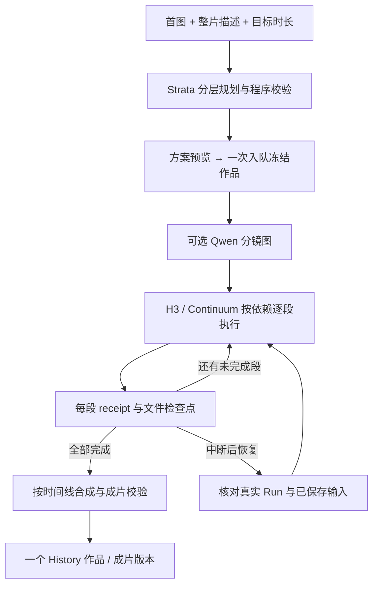

# 长视频模式：从一张图与整片描述到一个完整作品

- 类型：Plan；状态：proposed / research-complete，尚未实施。
- 日期：2026-10-18；适用：Local Video Studio 0.66.0 当前代码、H3 / Continuum / Strata / 可选 Qwen Image 2.1。
- 唯一任务状态：[TASK](TASK.md)；事实和来源：[研究证据](evidence/research.md)。本提案不改写现行契约，也不接续已归档方案的完成状态。
- 边界补正（2026-10-18）：用户明确原生单次30s和本长视频编排是两个功能；[原生30s独立调查](../2026-10-18-h3-native-30s/TASK.md)拥有该能力的资料/接入/验收，本计划不把它放进自己的P0，也不要求两项相互等待。

## 1. 建议加入什么

新增 Create 内独立的“长视频”模式。用户上传首图，描述整片想发生的事情，填写如 `02:00`，选择“自动安排 / 单镜头 / 多镜头”，点击“生成方案”，检查概览后点击“一次入队”。后续自动执行并输出一个完整视频，不要求逐段手写 prompt、逐段 Continue 或手动拼接。

产品中的三个层次必须清楚：**作品**是用户管理的对象，**镜头**是叙事与剪辑单位，**生成段**是模型的计算单位。一个镜头可以由多个 Continuum 段组成；一次模型生成也可能包含多次语义切镜，首版为可控修复优先显式管理镜头，不依赖模型自行完成所有切镜。

默认自动完成全部计划。方案预览是用户可修改的创作结果，不是每段审批流程；只在缺依赖、资源不足、协议错误或执行失败时停下。提供可选“先做首段预览”，不把它变成每次生成的强制关卡。

首版以 **30–120 秒、已有 H3 设置与用户已有模型**为验收范围。10 秒是初始候选段长，实际选择受动作密度、真实帧预算、段数、机器资源与质量实验约束。两分钟复杂长片是必须完成的最终验收样本，不以 10 秒演示冒充交付。

## 2. 上限与时长策略

| 范围 | 已查事实 / 产品建议 |
| --- | --- |
| H3 公布规格 | 官方模型卡与 CLI 公布 4–15 秒；不能把它写成本地原生节点不可超过的硬上限。 |
| H3 原生长采样候选 | 已取得完整30s workflow并排除时间拼接；这是现有Create的独立时长能力，证据与放开范围由[原生30s调查](../2026-10-18-h3-native-30s/ASSESSMENT.md)维护，本长片模式不定义其上限。 |
| Continuum Run | 3.9.1 与 3.9.8 公开 Sampler 的 `chunks` 为 1–16；同一 Run 使用共同 `chunk_seconds`。 |
| Continuum 段长 | 源码允许 4–30 秒，上游推荐 5–15 秒；超过 15 秒不作为首版生产方案。 |
| 单 Run 算术范围 | 10 秒×16＝160 秒；15 秒×16＝240 秒；30 秒×16＝480 秒。实际可见帧、资源和质量均须另验。不能写“无限长”。 |
| 本应用旧 Extend | bootstrap 的 catalog 上限是 14 秒（含上下文的 362 帧预算）；managed workflow policy 可以是 15 秒。不能统一改成 30 秒或把总片长填入旧 `Draft.duration`。 |
| 首版产品范围 | 目标 30–120 秒，完整验证后才放开更长档位；长度输入与“本环境可执行上限”分开显示。 |
| 后续更长作品 | 多镜头作品可由多个 Run 组成，先以 5–10 分钟作为后续实验范围；没有本轮 runtime 证据。单镜头超过单 Run 上限须明确拒绝或提供用户选择的章节方案，不能暗中插入切镜或伪装无缝跨 Run。 |

能力由已选择的 adapter、已审阅上游版本、真实 schema 和应用验证共同决定。更高的 schema 数字不能自动放开产品范围；机器资源检查也不能从测试机器的显存静态推断。

原生单次30s在现有Create里独立接入和验收，用户无需创建长片plan、子任务或多个Run。长视频模式将来可消费已经验证的原生profile，减少某些镜头的生成段数；原生30s交付不等待本计划，本计划也不把该独立功能当作首版强制依赖。

### 时长不能只做 `ceil(总秒数 / 15)`

1. 先把用户动作/对白/转场编成事件，再选择镜头与连续区间；事件密度决定是否需要更多段。显式时间点、台词原文、单镜头禁切镜等是硬约束。
2. 程序选择合法段长和段数，受每 Run ≤16、模型帧预算及同 Run 等长约束限制。Strata 提出节奏，程序校验并求合法布局；不让模型自行决定算术正确性。
3. 将全片时间、镜头时间、段内时间分开，使用整数帧与音频采样点记执行时间。H3 的 `5 + 17n` 原始网格、22 帧上下文和官方 assembly trims 分别处理，不能从名义秒数推算全部 tensor shape。
4. `120s → 12×10s` 是概览例子。真实编译后记录每组采样帧、上下文、净输出帧、计划导出区间与实际解码帧；根据真实净贡献重新检查覆盖。若合法表示需要尾部余量，规划时让结尾动作提前完成并留短暂 hold，最终按帧裁到目标长度。
5. 首版整数秒导出目标以 `round(seconds×24)` 为准，容差最多 1 视频帧；音频按目标采样点对齐，codec padding 单独记录。不能靠减速、重复长段或裁掉必要动作补时长。
6. 不为一个短尾段重新设定现有 Run 的 `chunk_seconds`。无法合法表示、需要明显延长或会切断台词时，方案显示原因并修改布局；不能在执行时悄悄变更已入队计划。

## 3. 操作设计

当前生产 DOM 在 `src/renderer/pages/create/page.ts` 使用 `input-mode-switch`、媒体区、主 prompt 区和 sticky submit bar。沿这套结构增加“长视频”同级模式，保持顶层 Create / Queue / History / Settings 导航。实现前以当前 DOM、1280×800、1440×900 及首个响应断点检查四模式切换，必要时折行为两行；不重建历史 prototype。

### 输入与生成方案

- 媒体区：首图必选（首版），可选额外角色/场景参考。首图作为真实 opening，不等同于每段都重新播放该图。后续可增加纯文本起片、从已有视频继续，但不成为首版前置范围。
- 主编辑器：一份“整片描述”，保留现有 undo、prompt versions、局部刷新和异步归属；方案是该描述的派生结构。段落细节按选中镜头展开，不并排放两个相互竞争的主 prompt 框。
- 基础选项：目标时长、自动/单镜头/多镜头、现有画幅/质量选择。高级区才显示段长、参考策略、种子、模型与资源摘要。
- “生成方案”调用 Strata，展示主体/场景约束、镜头安排、预计视频段与分镜图数量、计划长度、待准备依赖和耗时范围。缺图片/描述/合法时长时给可见原因；不调用模型。
- 允许一句话修改方案，例如“前半段不要切镜，结尾拉远”。修改产生新 plan revision，显示受影响镜头；锁定用户编辑过的片段，失败保留旧方案。生成期间切去其他模式，完成只更新所属草稿。
- sticky bar 的主按钮随阶段变成“生成方案”或“一次入队”。已生成但与原稿/图片/时长不匹配的方案标为待更新并阻止误提交。

分镜图策略提供“关闭 / 自动需要时 / 每镜头一张”。没有图片模型时，自动策略在预览里明确可执行替代方案；已确认计划依赖 Qwen 时，缺件须阻塞，不能在后台悄悄换模型或删图。单镜头首版默认不生成中间图。

### Queue 与 History

- Queue 一个作品卡，展开显示 `准备 → 分镜图（若有）→ 视频段 7/12 → 合成 → 校验`。总进度按阶段/预计工作量投影，当前 sampler step 单独显示；没有校准前不显示精确完成时间。
- “本段完成后暂停”是作品内部 checkpoint，保留当前作品位置；全局队列 divider 仍位于作品之间。立即取消只取消本作品当前操作，已验证片段保留供恢复，不删除媒体。
- History 一个作品入口，默认播放最终合成视频；详情可展开镜头/生成段、prompt、来源图、Take、失败/恢复信息。不是把全部中间片各放一张卡，再靠标题分组。
- 重做镜头、导出已完成部分、重新合成、继续未完成作品都是详情动作；返回保持 History 父导航、筛选、滚动与播放意图。部分导出标“未完成预览”，不能冒充完整作品。
- 最终作品沿用现有收藏、评分、标签和 LAN 视频浏览投影；中间素材不默认暴露到 LAN 列表。LAN 的编辑权限不因长视频而扩大。

## 4. Strata 分层规划

Strata 是本地推理引擎，当前生成内容的模型是 catalog 中的 Qwen3.8-Flash-Next 变体。复用其模型选择、认证、媒体准备、tokenizer、资源 owner、流式进度与取消；**不调用独立 Strata Agent 工具包替应用操控 UI，也不执行模型生成的工具/脚本**。

当前 `enhancePromptWithStrata()` 返回一份 H3 单段正文，32K 上下文、图片/输出预算和有界思考均有适用范围。长片需要新的结构化 planner contract，不能把 120 秒塞进现有 15 秒增强器并把输出用正则切开。

| 阶段 | 输入 | 输出与校验 |
| --- | --- | --- |
| A 看图与约束 | 首图、原稿、明确时长/镜头偏好、能力摘要 | 可见主体/服装/道具/场景事实；用户硬约束、事件表、模糊点与创作假设。避免把推测当成看图事实。 |
| B 整片规划 | A 的资料与用户原文 | story beats、镜头/连续区间、事件覆盖、对白归属、起始/结束状态、粗节奏。程序编译合法的 run/chunk/frame 布局。 |
| C 段落扩写 | 固定全局资料、所属镜头、段内事件、前后计划状态、合法执行时长 | 各段详细 H3 prompt、音场、交接状态与引用。段内时间从 0 起，全片事件时间只由编译器转换。 |
| D 一致性检查 | 结构化方案、已扩写结果和原稿事件表 | 无遗漏/重复动作、角色/道具状态衔接、对白不无故重复、镜头选择符合意图；模型检查只是候选评估，硬规则另验。 |

按镜头或小批（候选 2–4 段）扩写，控制输入+图片+思考+输出不超过实际 tokenizer 预算。全局视觉资料先提取再复用；不同视角/新素材仍需对应视觉输入。每次保留原始硬约束，不无声压缩用户长稿。超限明确指出可拆的输入，不截断凑通过。

每个结构单元最多一次模型纠正；每轮生成方案的全局自动纠正预算也须有限（建议最多 2 次），耗尽则保留已完成结果并显示待修位置，不能 12 段各自无限重试。JSON schema/grammar 若 Strata 适配真实支持则启用，否则按严格 parser 验证；本轮未证明其 schema 强制能力。思考内容不保存到作品 prompt；模型输出字符串只作数据。

必须新增有判别力的规划校验：时间覆盖/无重叠、合法段数、事件唯一映射、角色/道具 ID、引用槽位、台词原文、禁止切镜、最终动作完成、帧/音频范围。不可复用“正文词数增长”作为长片规划正确性的主要门禁。

### 计划状态与实际状态

预先生成整片计划和各段 prompt，满足一次入队。`plannedStart/End` 是期望，不代表画面已做到。每段完成先验证文件/receipt/网格/音轨；首版只自动接受技术完成，不宣称模型已理解剧情或身份完全一致。

可选的后续能力是用真实末帧做有界“检查并修正后续未执行段”。它必须经历释放 H3→加载 Strata→保存新的执行 revision→释放 Strata→继续，保留原入队计划和所有修改记录。若实际状态偏离硬剧情，应暂停或从受影响段重做；不能编造“已经交出钥匙”掩盖失败。该闭环不作为首版自动启用项，以免每段切模型产生高成本。

## 5. 连续镜头与多镜头的执行选择

### 单镜头

未来已验证的原生30s可作为镜头执行provider；本计划当前下述协议限定Continuum，不能把其16段限制推导为所有H3原生图的时长限制。

用一个新的官方 Run，从用户首图生成第一段，后续段使用匹配的 AV latent / official accepted prefix。每段描述新增动作，明确接上一段的状态，不重复“从头走进画面”。保留统一画幅、FPS、模型/LoRA、采样、attention、VAE、cache、参考身份和 run identity。

必须实现正式的 **new-run 创建入口与首段 graph/receipt**。这个入口允许空前缀创建自己的新 Run；旧 Extend 的“从已有 Run 继续”仍要求 acceptedChunks>0，不修改其检查来兼容新入口。首段成功后持久化真实 manifest v6/hash/resume_safe/head，再构造下一段。

一个 Run 内等长；最后一段处理为合法时长＋计划好的尾部 hold/导出裁切。首版不加 Last Image 终端约束，避免 terminal merge 将两逻辑段变成一物理组；底层数据仍保留 physicalGroup，后续加入时按整体重做/取消，不拆组。

### 多镜头

每个明确切镜后的连续区间使用独立 Run，绑定同一作品的角色/道具/场景资料与图资产。区间内仍可 Continuum 续接，区间之间按剪辑计划硬切。不要给新镜头硬塞上一镜头运动 latent，强求无缝会妨碍机位和空间变化。

自动模式倾向在自然事件/场景边界安排镜头；用户明确单镜头时不得擅自改成多镜头。多镜头中的区间可不等长，但各 Run 内仍受共同段长限制。重做某镜头可以保留其他独立镜头，只有显式素材/状态依赖的后代失效。

### Qwen 2.1 放在哪里

优先作为 **镜头开场图或角色/场景参考图**：从用户原图/已锁定角色参考＋目标机位/环境生成新图，然后交给对应 H3 路径。Qwen 多图能力与当前图像 adapter 可复用；生成图的身份准确性仍需验收，不能因“多图编辑”就保证一致。

同一动作的中间帧不是“必需桥接件”。只有必须精确到达某姿态/构图时，才实验锚点/首尾帧路径；参考图不等于时刻约束，FL2VA 首尾图、Ref2VA 身份参考、Continuum per-chunk reference 的语义不同。不得把 Qwen 输出接进未注册/未支持的 middle-keyframe socket。

分镜图按规划先生成并缓存，再批量运行 H3，减少 Qwen/H3 反复装卸。若某图必须来自实际上一镜头末帧，则把依赖明确写入 DAG，承担串行模型交接。图片子步骤使用冻结 image task snapshot/adapter，不写 `imageDraft`、不切到图片页、不额外制造一堆独立图片项目；支持显式“保存到图片库”。

V3.9 的九槽/per-chunk reference 是候选能力，不要求为了首版单镜头自动切换 workflow family；从当前 V3.8 兼容图迁移要另验 schema、引用映射和 Run 兼容性。

## 6. 任务、作品与恢复的数据边界

建议增加版本化 `LongVideoDraft`、`LongVideoPlan`、`LongVideoRun` 和新的 `LongVideoQueueTask`，独立于旧视频 `Draft.duration` 与 `ExtensionQueueTask`。以下为待实施的概念字段，不是已经存在的 IPC 或兼容承诺：

| 对象 | 最少内容 |
| --- | --- |
| Draft / Plan | brief revision、plan revision/hash、目标秒/帧、模式、素材身份/hash、角色资料、事件、镜头、Run/段布局、每段 prompt、引用和导出时间线。 |
| 队列快照 | 唯一 parent taskId/projectId、冻结 plan、seed 派生规则、运行 profile/模型身份、总资源计划。用户后续改草稿不会影响它。 |
| 子步骤定义 | stepId、shotId/runId/chunkIndex/physicalGroup、依赖 ID、执行类型（image/video/assemble/validate），先绑定定义而非尚不存在的路径/head。 |
| 执行日志/checkpoint | resolved-input revision、真实父 head/accepted、Comfy promptId、attempt、官方 receipt、输出 hash/帧/音轨、失败阶段、下一可恢复边界。 |
| 作品与成片版本 | 单一 History asset/project identity，最终输出版本、plan/run 关联、编辑时间线、中间素材引用与 owner、部分预览状态。 |

逻辑关系：`作品 → plan revisions → queued execution → runs/shots → steps/takes → 成片 versions`。一个全局 queue task 拥有多个内部步骤，不把所有步骤伪装成可以任意拖动的普通 queue cards。

计划与运行事实分开：第一段尚未产出的 AV/head 在创建计划时只能是依赖引用；领取下一步骤时从已经确认的 checkpoint **原子绑定一次**并保存为其执行快照。重启/重试复用同一绑定，父 head 不匹配就拒绝，不再次读取草稿或追随外部更新。认领后可变全局设置也不能让同一 Run 中途换 VAE/attention/profile；旧任务的既有设置例外保留。

建议状态机：`waiting → preparing → rendering → assembling → validating → completed`，中途可 `paused / failed / cancelled`，恢复进入上一个已确认 checkpoint 后的步骤。继续已有父任务保持 taskId；改变计划或已完成片段的创作内容创建新 execution/成片版本，保留旧身份和输入，不能原地改已完成快照。

### 失败与提交原子性

- 单步 receipt、文件解码与身份核对成功后才前进。超时/断线先查询原 promptId 与官方 Run；无法证明未提交时不得再投一遍。
- 官方 Run 写入不是应用数据库事务。提交前守卫继续使用真实 head 和 Run 锁；提交后 app checkpoint 尚未写入时，重启读取实际 manifest 做 reconciliation。不能假定任务失败就没有磁盘变更，也不承诺自动回滚上游文件。
- 用稳定 operation/step/attempt 标识和幂等提交记录，覆盖“采样完成→checkpoint”“合成完成→History”间隙。恢复只采样缺失/失效段，单独合成失败只重合成。
- 重做连续镜头第 k 段，k 后方沿真实状态依赖的段标 stale，从该处创建官方分支；不得把旧后缀接到新动作。独立镜头不受影响；terminal physical group 整组处理。
- 完成前先写临时成片、ffprobe/实际读取校验，再原子发布最终路径和 History version；崩溃可发现已写出但未登记的成片，不能重复 History 卡。
- 中间素材/latent/官方 Run 进入资产引用图。重命名、转移、删版本、删作品、取消后清理、共享引用和别名都通过现有 owner/registry 规则；清理断点不能删仍可恢复或被别的版本使用的材料。
- 旧 state 无新字段则保留旧行为。新任务类型、持久化字段、IPC、History 聚合与 schema migration 在实施时更新契约并验旧队列/历史，不直接把研究文档当迁移授权。

## 7. 资源与合成策略

单机始终只运行一个重 GPU 阶段：`Strata 规划 → 确认释放 → Qwen 分镜图（若有）→ 释放 → H3 逐段 → 解码/合成 → 可选后期`。复用现有 runtime owner / queue 交接，避免独立服务绕过租约；远端仍 connection-only，不能停止远端服务或其他任务进程。

按步骤记录 dedicated/shared VRAM、物理 RAM、commit、磁盘空间、加载/采样/解码/编码/合成耗时。基于已有资源检查计算 admission，不能通过调低保护线保证长片“能跑”。当前 Strata 有资源与稳定性负结果，第一阶段只做有限样本，不能声称已适合无人值守整夜生产。

**避免每续一段重新解码/编码全前缀。**优先验证官方 Review 的当前物理组输出能否单独持久化；最终只做一次整片组装。官方 Run Storage 保持 continuation 真源，应用分段 MP4 用于预览/最终封装，两者不可混为一个状态源。

当前与候选版本的 Review/Finalize 行为及现有 receipt 对完整前缀的要求必须由 P0 实测确认。若 3.9.1 只能反复解码前缀，不能声称加一个 FFmpeg concat 就消除了该开销。有限候选顺序：先验证 3.9.8 官方输出边界；若不能使用单组输出，评估官方 Full Run＋其磁盘 checkpoint＋末尾一次 Finalize。两者都不满足资源/恢复门槛时，停在该工程阻塞，不复制采样器或放宽契约来凑 MVP。

最终合成遵守 official assembly 的 net frame/trim/context，不能再次减掉已经去除的 22 帧。保持官方单 Run seam 结果；跨镜头默认硬切，不用画面 crossfade 掩盖错误运动。音频同镜头沿 AV 延续，跨镜头短淡化只限不切断台词的允许边界；不保证声线、口型和整曲音乐天然一致。外部完整配乐/对白轨是后续显式功能，首版不生成额外 TTS/字幕系统。

编码参数完全匹配时才尝试 stream-copy concat；否则预先规范编码并显示实际编码阶段，不能一律承诺无损。合成过程用文件流/分组解码，避免两分钟 RGB 全帧常驻内存；disk-backed Finalize 也不能保证上游 decoder 无大分配。首版不默认插帧/超分；后续把完整成片送现有 Upscale，沿用其分段检查点。

ETA 从实测样本构建范围，分开一次模型加载、各段采样、解码、分镜图、编码/合成；未测前显示“待首段估算”。不把他人 GPU 的几分钟宣传换成本机承诺。

## 8. 实施接缝与阶段

现有路径为下列入口；新模块名均为建议。不向 `main.ts`、`application-runtime.ts` 或 `comfy-ui.ts` 堆入整套导演逻辑。

| 范围 | 复用 / 建议扩展 |
| --- | --- |
| Create 模式 | `src/renderer/contracts.ts`、`pages/create/page.ts`、`coordinator.ts`、prompt controller；拆独立长视频 controller / view-model，旧三模式快照独立恢复。 |
| 规划纯逻辑 | 新 `src/core/long-video/`：plan schema、事件/时间校验、frame layout、依赖与失效计算；模型能力从现有 catalog/adapter 读取。 |
| Strata | 新 focused planning service；复用 `strata-runtime-owner.ts`、`strata-reference-media.ts`、token budget 和 lease，不改旧 `enhancePrompt...` string 返回契约。 |
| 工作流 | 新 new-run graph 与独立 long-video adapter；复用 `workflow.ts`、`h3-workflow-contract.ts`、managed receipt 与 `managed_prefix_guard.py`，保留普通 H3/Extend。 |
| Queue | `queue-task-factory.ts`、`queue-enqueue.ts`、executor/worker、queue state / mutation service；长片 orchestrator 作为一个父任务执行器，内部步骤落盘。 |
| 图像生成 | 复用 `src/core/image-workflow/qwen-image-2-1.ts` 与 image task snapshot / output 收集，不通过改 renderer draft 提交。 |
| 作品与素材 | `src/types.ts`、store/state repository、History output collection、`h3-continuum-asset-registry.ts`、asset resolver；增加明确引用和聚合，不靠标题猜归属。 |
| 媒体 | 从 `extension-media.ts` 的 FFmpeg 基础设施抽共享 helper；独立合成服务接收经过校验的 edit timeline，不重用“源视频＋新段”假设做任意多镜头。 |

### P0：两个风险先做有限验证

交付可复用的能力报告和 adapter 决定，不做新大 UI。恢复现有真实 managed 证据，固定 selected core/data/Python、节点版本/hash、权重及资源归属。优先复用已有成功前缀和隔离素材。

1. 固定候选：catalog 3.9.1 / `94eaf70…` 为当前应用基线；3.9.8 / `58fbd855…` 为升级候选。先做 source / graph，确有需求再在获授权实施环境使用安装事务升级，不能本轮研究自动安装。
2. 从首图创建真实新 Run，做 2×5s，再恢复产生第三段；分别确认首段入口、v6/hash/head、reused/generated、单组/累积输出、assembly trims、取消/重启恢复。API fixture 仅证明执行层，正式 UI 门禁留 P2。
3. 一段10s 的资源样本＋受限 Strata `30s/3段` 与 `120s/约12段` 规划样本，单镜头和多镜头各一个；检查完整事件/台词、结构和 token 预算。最多每样本一次纠正，未通过就记录，不换 seed 循环抽到成功。
4. 定义停止条件：不明进程归属、资源硬门槛触发、prefix/hash 不符、A/V 不同步、重复裁切、崩溃或不能可靠恢复即停止当前扩展实验。现有蓝屏调查结论不被新计划覆盖，不动驱动/分页文件/其他程序。
5. 固定资源预算后，P0 最多 4 次新增 H3 小段采样（2+1 段与 1 个10s样本）、4 个规划样本；已有合格证据可抵扣。若需要额外实验，先写明新假设和预算，不能自动扩成长片压力测试。

原生15/20/30s单次能力的接入与实验归[独立任务](../2026-10-18-h3-native-30s/TASK.md)，不计入本P0、不作为本P0前置，不用Continuum拼接成功代替其验收。

P0 验收：正式 new-run 能力可行、合法时长算法可确定、自动规划结构过关、选择可承受的解码/恢复方案。质量风险明确留到真实长片；不把 P0 当作两分钟交付。

### P1：长片内核与计划

实现 plan schema、独立草稿、分层 Strata 请求、纯校验、父任务及内部依赖状态机、new-run/append adapter、单作品输出提交与恢复。先覆盖单镜头，保留多镜头数据结构；静态 fixtures 验错误输入、失效传播、重复提交和 migration。

验收：实际 AppApi 能创建一份冻结父任务，失败/重启能定位下一步骤，旧任务照常；focused＋typecheck，涉及共享状态/queue/workflow 的整合状态跑 verify。尚无新 UI 时不宣称用户可用。

### P2：可用的单镜头 MVP

加入第四模式、方案概览、一次入队、Queue 单卡、History 单作品、部分预览与恢复；先 30s，再一个完整 120s复杂动作样本。新入口必须实际走“缺图片/描述→可见阻塞→补齐→生成方案→真实按钮→parent taskId”，队列继续采用真实 Start 按钮。

验收：12段示例或编译出的等效合法布局完整完成；实际解码、目标帧数/音轨、全部接缝、首图/动作顺序与结尾、History 播放/返回/重启、失败段恢复、只重合成、引用保护全部留证。不承诺所有剧情都达到主观质量标准，明确该样本遗漏和漂移。

### P3：多镜头与可选 Qwen 分镜图

加入自动/多镜头、切镜计划、Qwen 子步骤与引用、镜头独立重做和最终 edit timeline。验收一个 120s、至少3镜头、至少1个多段连续镜头的样本；包含图像阶段真实输出、模型互斥、身份/服装/道具延续和切镜音频。缺 Qwen→补齐→真实一次入队；关闭分镜图的路径也可用。

P2 是首个可用交付；P3 完成用户描述的单镜头/多镜头完整范围，不能把 P2 宣称为全部完成。

### P4：扩展长度与修复能力

以 P2/P3 的实际耗时、磁盘、内存和质量决定放开 4min 单 Run 档位及更长多 Run 作品；独立评估实际末帧反馈、局部后续重规划、角色参考库、首尾帧锚定、整片配乐和后期。每项有独立预算和回归边界，不并入首版承诺。

## 9. 验收矩阵与版本边界

| 层 | 必须有的有判别力证据 |
| --- | --- |
| domain | 16 段边界、非法总时长、非整段尾部、全片→局部时间、对白跨界、事件遗漏/重复、引用错位、禁止切镜、连续后缀失效与独立镜头保留。 |
| persistence / IPC | 旧 state/旧 queue/旧 History、长片 waiting/running/failed/assembling 恢复、plan 与 resolved inputs 冻结、重复回调/重启仅一个成片版本。 |
| graph / protocol | new-run 与已有前缀不同 gate、真实 schema、官方 Run 锁、v5只读、v6/hash/resume_safe、parent head 竞争、physical group 与 receipt/assembly 对齐。 |
| UI | 四模式恢复、输入缺失与恢复、真实 click→ID、规划异步切页/取消、连续输入/焦点/undo、单卡进度/暂停/重排、History 父页/播放、两桌面尺寸和断点。 |
| runtime | A→B→C、30s→120s、同一作品全部段与帧/音轨；取消、重启、断线不重复提交、合成失败仅合成、Qwen→H3互斥及资源收尾。 |
| quality / benefit | 原稿事件覆盖、角色/服装/道具、运动接缝与漂移、镜头节奏、对白和音画；相同输入/参数与手动逐段路线做有限比较，记录失败，不以测试通过宣称更快/更好。 |

实施按 [验证规范](../../CHANGE_VERIFICATION.md) 使用 focused / verify / 真实 app harness；若修改 managed guards，补对应 Python tests。最终需新增 `long-video` journey 并同步 runbook/harness guide，不能现在引用一个不存在的 guide 命令。

本轮为文档研究，无运行行为和版本变化，不向已有 dirty CHANGELOG 插入“已支持长视频”。功能落地预计 minor；需要新增持久化类型和 IPC，实施时同步契约及显式 migration。发布/打包仍须另有用户授权。
