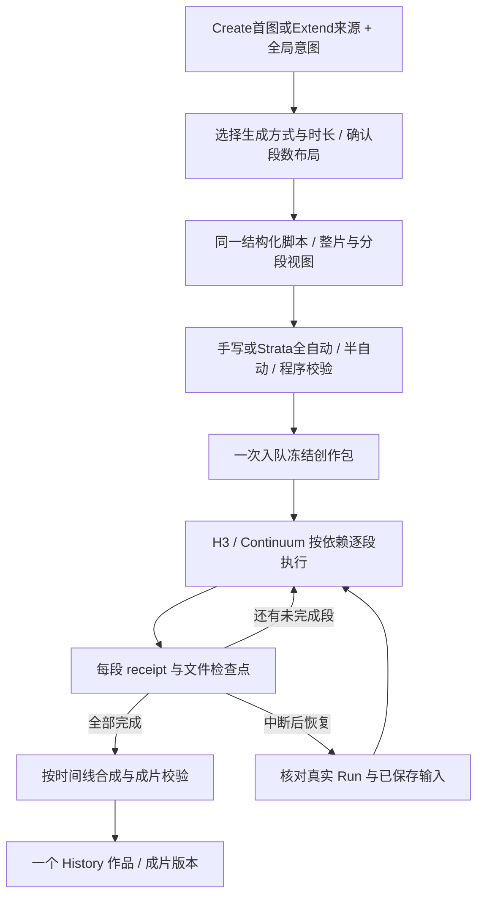

# 长视频编排：Create / Extend 内的整片脚本与分段生成

- 类型：Plan；状态：proposed / P0-offline-assessed，生产功能尚未实施。
- 更新：2026-10-20；适用：Local Video Studio 0.66.4（前轮交互基线0.66.3），H3 / Continuum / Strata。
- 唯一任务状态：[TASK](TASK.md)；事实和来源：[研究证据](evidence/research.md)。本提案不改写现行契约，也不接续已归档方案的完成状态。
- 边界补正（2026-10-18）：用户明确原生单次30s和本长视频编排是两个功能；[原生30s独立调查（已归档）](../../archive/h3-native-30s/TASK.md)拥有该能力的资料/接入/验收，本计划不把它放进自己的P0，也不要求两项相互等待。
- 本版替代：2026-10-18的“第四个长视频模式”、按镜头展开编辑与原P0-P4拆分由本版替代；早期研究、预算边界和未验证事实仍保留。当前明确的交互与下述建议分开记录，不把计划当作已上线能力。

## 1. 建议加入什么

沿用现有 Create 图生视频与 Extend，不新增第四个创建模式。在“时间与运动”中增加生成方式：原生、原生解锁、Continuum多段；用户以一张图和少量意图开始，也可手写整片脚本。确认时长/段数布局，手写或借助 Strata 补齐各段，一次入队，最后得到一个普通长视频作品。

产品层次：**作品/创作包**是用户提交和管理的对象；**Run**是冻结兼容条件下的连续生成序列；**逻辑段**拥有自己的提示词和时间区间；**物理组**是实际采样、提交与恢复单位。镜头是叙事单位，不要求一段就是一次切镜。一个Run可以包含多个段prompt，不能理解成H3一次读取整片长稿并生成全部时长。

默认按确认的计划自动执行；提示词“全自动/半自动”描述写作方式，不控制是否逐段审批。保留段后暂停、查看、重生成和继续，不强制每段确认。全局意图、段落提纲和实际prompt是不同层，不能把同一整片动作反复塞给每段。

当前提案上限为一次创作包120秒；Continuum允许短片布局，不能强制至少30秒。30秒用于首个真实闭环，120秒用于完整范围验收。已有H3设置、模型与回退路径保留；多镜头独立编排、Qwen分镜图和超过本范围的作品留作后续增量，不成为基本交互的前置。

## 2. 上限与时长策略

| 范围 | 已查事实 / 产品建议 |
| --- | --- |
| H3 公布规格 | 官方模型卡与 CLI 公布 4–15 秒；不能把它写成本地原生节点不可超过的硬上限。 |
| H3 原生选项 | 提议UI以“原生”保留15.1秒常规上限，“原生解锁”允许至30秒；这是显式选择而非质量推荐，旧快照/已支持回退保留。工程证据由[独立调查（已归档）](../../archive/h3-native-30s/ASSESSMENT.md)维护。 |
| Continuum Run | 已查3.9.1、3.9.8与3.9.9公开Sampler的 `chunks` 为1–16；同一Run使用共同 `chunk_seconds`。16段是累计上限，不是每次Extend可以再加16段。 |
| Continuum 段长 | 源码允许 4–30 秒，上游推荐 5–15 秒；超过 15 秒不作为首版生产方案。 |
| 单 Run 算术范围 | 10 秒×16＝160 秒；15 秒×16＝240 秒；30 秒×16＝480 秒。实际可见帧、资源和质量均须另验。不能写“无限长”。 |
| 当前应用与提案 | 原生30秒已独立完成工程验证，不代表语义时长利用率或运动质量合格；旧14秒说明不再作为当前入口事实。已有managed Run沿用冻结段长，不把整片总长直接填入旧 `Draft.duration`。 |
| 首版产品范围 | Continuum创作包4–120秒；Create填写目标成片时长，Extend填写本次新增时长，另显源长与预计总长。布局还受Run剩余段数、帧网格和实际资源约束。 |
| 后续更长作品 | 多镜头作品可由多个 Run 组成，先以 5–10 分钟作为后续实验范围；没有本轮 runtime 证据。单镜头超过单 Run 上限须明确拒绝或提供用户选择的章节方案，不能暗中插入切镜或伪装无缝跨 Run。 |

能力由已选择的 adapter、已审阅上游版本、真实 schema 和应用验证共同决定。更高的 schema 数字不能自动放开产品范围；机器资源检查也不能从测试机器的显存静态推断。

用户反馈的三次原生30秒生成出现动作提前完成、循环、倒退、切镜/重复及较高耗时。这是当前使用场景的负结果，不是所有模型组合的普遍结论；因此保留实验性解锁，不把它作为长片默认路线，也不假定加长prompt能修复。

### 初始段数建议

对新Run，使用上游Easy的约10秒目标作为初始化启发式：默认 `ceil(T/10)`，推荐范围 `ceil(T/15)` 至 `min(16, floor(T/5))`；4秒至不足5秒单独允许1段。这里只生成名义布局，不声称是实测最优值。

| 总时长 | 推荐段数 | 初始建议 |
| --- | --- | --- |
| 15秒 | 1–3 | 2段，每段名义7.5秒 |
| 30秒 | 2–6 | 3段，每段名义10秒 |
| 60秒 | 4–12 | 6段，每段名义10秒 |
| 120秒 | 8–16 | 12段，每段名义10秒 |

用户可调整合法段数；低于5秒与高于15秒不伪装成同等推荐。分段多会增加交接/调度，分段少会提高单段成本与重做代价。既有Run的Extend不重新平均源片段，而是按冻结段长和剩余容量编译新增布局；无法精确表达时先显示可行时长与原因，由用户确认。

### 时长不能只做 `ceil(总秒数 / 15)`

1. 先把用户动作/对白/转场编成事件，再选择镜头与连续区间；事件密度决定是否需要更多段。显式时间点、台词原文、单镜头禁切镜等是硬约束。
2. 程序选择合法段长和段数，受每 Run ≤16、模型帧预算及同 Run 等长约束限制。Strata 提出节奏，程序校验并求合法布局；不让模型自行决定算术正确性。
3. 将全片时间、镜头时间、段内时间分开，使用整数帧与音频采样点记执行时间。H3 的 `5 + 17n` 原始网格、22 帧上下文和官方 assembly trims 分别处理，不能从名义秒数推算全部 tensor shape。
4. `120s → 12×10s` 是概览例子。真实编译后记录每组采样帧、上下文、净输出帧、计划导出区间与实际解码帧；根据真实净贡献重新检查覆盖。若合法表示需要尾部余量，规划时让结尾动作提前完成并留短暂 hold，最终按帧裁到目标长度。
5. 首版整数秒导出目标以 `round(seconds×24)` 为准，容差最多 1 视频帧；音频按目标采样点对齐，codec padding 单独记录。不能靠减速、重复长段或裁掉必要动作补时长。
6. 不为一个短尾段重新设定现有 Run 的 `chunk_seconds`。无法合法表示、需要明显延长或会切断台词时，方案显示原因并修改布局；不能在执行时悄悄变更已入队计划。

## 3. 操作设计

当前生产DOM位于 [Create page](../../../src/renderer/pages/create/page.ts)。保留现有创建路线、媒体区、主prompt区与提交动作；图生视频/Extend共用下述投影。实现时检查1280×800、1440×900、首个响应断点及移动窄屏，不重建历史prototype。

### 参数布局与确认

- Create与Extend均把“时间与运动”移到LoRA上方。H3时长旁原来不可选的24fps控件改为生成方式下拉；24fps仍是实际输出条件，可在摘要显示。其他模型原有可选FPS保留。
- 生成方式为“原生 / 原生解锁 / Continuum多段”；模型/检查点选择与生成方式是两个维度。可用性按capability、adapter和依赖投影，不显示尚未实现的方法占位，也不静默切换模型/LoRA。
- 多段模式显示总时长与段数，推荐后允许修改。确认按钮只应用布局、建立稳定段ID和编辑页，不隐式调用模型或提交队列。之后改时长/段数需重新确认，保留文本和历史，标记受影响项。
- 全局页显示并编辑整包时长；编号页显示本段时长/全片区间，常驻整包总长与段数摘要。编号页不独立修改同Run段长。语义动作可跨段或长短不一，逻辑段与实际物理组/帧贡献不能混同。
- 一张图足以进入基本创作；不要求角色设定集、多视角、场景库或额外图片模型。没有文字但有图时可生成创意；用户给了意图则保持其约束。纯手写的有效脚本也可直接入队，不强制使用Strata。

### 一份脚本，两种编辑视图

分页不是Continuum运行前提。建议提供“整片 / 分段”视图：底层只有一份结构化脚本，包括全局意图、约束、布局、各段提纲与实际prompt；不另存两份会相互覆盖的长文本。

- 分段视图沿用户指定位置，在编辑器与快捷插入之间放 `[全自动/半自动] | 全局 | 1 | 2 | ...`；切页只切当前编辑对象。整片视图在同一编辑器通读/编辑全局与全部段内容，不新增第二个竞争的主输入框。
- 编译时导出上游支持的Timeline段标记，如独占一行的 `[Chunk 1]`；UI编号是本包顺序，Extend编译到Run中的真实段号。稳定段ID不随显示编号改变。
- 允许整片长稿/粘贴脚本；万字脚本是创作资料，不意味着H3每段都接受全部文字。全局硬约束按需编入本段，事件只分配给所属段；Strata与H3分别按真实tokenizer/编码器预算校验。
- 整片视图可暂存不完整标记/未闭合编辑；解析失败保留原文和上次有效结构，显示错误位置，阻止受影响的增强/入队。显式段标记丢失或重复时不能猜分段，更不能用正则切段后覆盖原稿。
- 无改动切换视图须无损；重新解析时保留可识别的稳定ID和版本，新布局不能仅靠页码匹配。无法确定映射时保留旧稿、提示确认，不自动拼接或丢弃历史。
- 每页独立prompt版本和编辑撤销；整包revision还记录采用的全局/布局/各页版本组合。整片编辑影响多页时一次提交关联变更，不把不同布局下的任意版本混成可执行快照。

### 全自动与半自动增强

- 全自动：全局增强结合图、全局意图、时长、已确认布局与显式加载的写作知识，先分配动作，再生成各页详细prompt；分批调用也必须报告已完成/待完成页，不把截断输出当作整包完成。
- 半自动：全局增强先生成可编辑的短提纲；编号页增强只扩写该页，参考全局、相邻计划交接与可用实际状态。提纲/详细稿/待复核状态明确，短稿不按字数强制凑长。
- 两种模式都允许手工修改和局部增强；全局再次增强生成候选新版本，对手工锁定页不得静默替换。切换工作模式不删除已有详稿。
- 异步请求绑定creation origin、draft ID、稳定page ID与revision；返回时不跟随当前页。已改变的输入只能获得待采用候选，不能解除新布局的阻塞。全局变更将依赖段标为需复核；纯创作提醒与真正结构错误分开。
- 布局确认、提示词增强、队列提交是三个动作。最终按钮始终提交整个包，并显示本次新增段数；查看第2页不意味着只提交第2段。缺件、提纲未展开或解析/兼容失败提供可恢复原因。

16页加全局/模式下拉不能挤占窄屏：编号采用可滚动窗口或紧凑分页，当前页与整包摘要可见；切换保留焦点、选区、未提交输入和增强进度。原生模式隐藏多段控件但保留多段草稿，以便切回。

### Queue 与 History

- Queue一个创作包卡，显示总段数，缩略图区用 `<1/5>` 浏览各段prompt及已有预览；未生成页明确待生成。浏览段与实际执行段分开，切换不触发采样或重置播放器。阶段显示 `准备 → 视频段7/12 → 解码/合成 → 校验`，当前sampler进度与整包进度分开，不以steps百分比冒充总进度。
- “本段完成后暂停”是作品内部 checkpoint，保留当前作品位置；全局队列 divider 仍位于作品之间。立即取消只取消本作品当前操作，已验证片段保留供恢复，不删除媒体。
- History一个普通长视频入口，默认播放器不改；prompt区保留“全局/编号页”，下方沿用Continuum状态面板。保留各段/参考来源/Take/失败恢复事实，不把中间片全部变成独立卡。
- “在创建页调整”恢复原始图生视频或Extend路线、生成方式、布局、整片/分段脚本与版本组合，生成新草稿/执行，不修改旧快照。“继续创作”进入Extend：预览完整成片，执行使用其匹配的尾部Run/AV状态；原始图片参考与已确认角色锚点随兼容来源携带。
- 重做当前段、导出已完成部分、重新合成和继续未完成包均须可达；返回保持History父导航、筛选、滚动与播放意图。部分导出标“未完成预览”，不能冒充完整作品。任意帧裁剪后接续不是本版已具备能力，需另建正确AV边界。
- 取消/错误保留完整已提交组；删除先停下本包操作并等待清理，再按owner/共享引用回收独占中间文件。普通Queue remove和History删视频不能冒充整包回收；仍被源片/分支/其他版本引用的Run与素材必须保护。
- 最终作品沿用现有收藏、评分、标签和 LAN 视频浏览投影；中间素材不默认暴露到 LAN 列表。LAN 的编辑权限不因长视频而扩大。

## 4. Strata 分层规划

Strata 是本地推理引擎，当前生成内容的模型是 catalog 中的 Qwen3.8-Flash-Next 变体。复用其模型选择、认证、媒体准备、tokenizer、资源 owner、流式进度与取消；**不调用独立 Strata Agent 工具包替应用操控 UI，也不执行模型生成的工具/脚本**。

现有增强器返回一份H3单段正文，32K上下文、图片/输出预算和有界思考均有各自适用范围。长片需要独立结构化planner contract；原生30秒工程支持不自动扩大Prompt Writer/Gemma等既有后端限制，也不能把120秒直接塞进单段增强器。沿用现有写作预设和知识组合入口，不把仓库Skill自动视为Strata已加载的知识。

| 阶段 | 输入 | 输出与校验 |
| --- | --- | --- |
| A 看图与约束 | 首图、原稿、明确时长/镜头偏好、能力摘要 | 可见主体/服装/道具/场景事实；用户硬约束、事件表、模糊点与创作假设。避免把推测当成看图事实。 |
| B 整片规划 | A 的资料与用户原文 | story beats、镜头/连续区间、事件覆盖、对白归属、起始/结束状态、粗节奏。程序编译合法的 run/chunk/frame 布局。 |
| C 段落扩写 | 固定全局资料、所属镜头、段内事件、前后计划状态、合法执行时长 | 各段详细 H3 prompt、音场、交接状态与引用。段内时间从 0 起，全片事件时间只由编译器转换。 |
| D 一致性检查 | 结构化方案、已扩写结果和原稿事件表 | 无遗漏/重复动作、角色/道具状态衔接、对白不无故重复、镜头选择符合意图；模型检查只是候选评估，硬规则另验。 |

按镜头或小批（候选 2–4 段）扩写，控制输入+图片+思考+输出不超过实际 tokenizer 预算。全局视觉资料先提取再复用；不同视角/新素材仍需对应视觉输入。每次保留原始硬约束，不无声压缩用户长稿。超限明确指出可拆的输入，不截断凑通过。

每个结构单元最多一次模型纠正；每轮生成方案的全局自动纠正预算也须有限（建议最多 2 次），耗尽则保留已完成结果并显示待修位置，不能 12 段各自无限重试。JSON schema/grammar 若 Strata 适配真实支持则启用，否则按严格 parser 验证；本轮未证明其 schema 强制能力。思考内容不保存到作品 prompt；模型输出字符串只作数据。

必须新增有判别力的规划校验：时间覆盖/无重叠、合法段数、事件唯一映射、角色/道具 ID、引用槽位、台词原文、禁止切镜、最终动作完成、帧/音频范围。不可复用“正文词数增长”作为长片规划正确性的主要门禁。

### 计划状态与实际状态

预先生成整片计划和各段 prompt，满足一次入队。`plannedStart/End` 是期望，不代表画面已做到。每段完成先验证文件/receipt/网格/音轨；首版只自动接受技术完成，不宣称模型已理解剧情或身份完全一致。

稳定身份参考与滚动尾部状态分开。原图中已有角色以用户来源为准；未规定的细节和新人物允许H3创作，首次清楚且被采纳的生成形象可成为后续参考。不得让每个最新尾帧自动覆盖身份锚点；只在真实看见输出后记录观察，不要求用户先补人物设定集。

P5补充提取、预览/采纳与未来段引用；如需自动视觉判断，必须有界地释放H3→加载Strata→保存后续执行revision→释放Strata→继续，不强制每段重载。身份采纳不等同自动证明所有剧情完成；更复杂的语义纠偏/反复自动重做仍属后续实验。已排队原始意图与已接受前缀保留，新观察只影响有记录的未执行段，不原地篡改冻结快照。

## 5. 连续镜头与多镜头的执行选择

### 单镜头

下述连续执行协议限定Continuum，不把其16段上限推广为所有H3原生图的时长上限；原生解锁使用已独立验证的profile，质量仍按实验性路径表述。

用一个新的官方 Run，从用户首图生成第一段，后续段使用匹配的 AV latent / official accepted prefix。每段描述新增动作，明确接上一段的状态，不重复“从头走进画面”。保留统一画幅、FPS、模型/LoRA、采样、attention、VAE、cache、参考身份和 run identity。

必须实现正式的 **new-run 创建入口与首段 graph/receipt**。这个入口允许空前缀创建自己的新 Run；旧 Extend 的“从已有 Run 继续”仍要求 acceptedChunks>0，不修改其检查来兼容新入口。首段成功后持久化真实 manifest v6/hash/resume_safe/head，再构造下一段。

一个Run内共用段长，实际净帧贡献可有网格差异；尾部以合法时长、已规划hold和导出裁切处理。默认不启用新的Last Image终端约束；原生既有首尾帧支持保留。多段若带Last Image，必须在P0确认可用路径及terminal merge限制，不支持时明确阻塞并保留输入，不能静默忽略。合并组整组重做/恢复，不能保证每个编号页都独立采样。

### Extend与Run容量

同Run续接冻结模型/LoRA、采样、几何、FPS、VAE、attention、参考有效契约与head。应用不能在取消后reset或waiting刷新时，将新全局加速设置注入已有兼容前缀；不兼容变化需明确新执行/新Run策略，不能从头重算后伪报复用。

一次包新增段数与Run累计段数分开记录。剩余容量不足时，UI显示原因及可执行范围；P5验证跨Run尾状态移交后才开放反复Extend超过16段。跨Run不插入未请求的切镜，不把clip后的MP4配旧尾latent；V3.9路由对initial state的限制也须由adapter确认。无法无损承接时保持阻塞和现有显式回退，不宣称无限续接。

### 多镜头

每个明确切镜后的连续区间使用独立 Run，绑定同一作品的角色/道具/场景资料与图资产。区间内仍可 Continuum 续接，区间之间按剪辑计划硬切。不要给新镜头硬塞上一镜头运动 latent，强求无缝会妨碍机位和空间变化。

本节属于后续独立多镜头编排，不在P0-P6的主交互中新增“自动/单镜头/多镜头”必选控件。未来可在自然事件/场景边界安排镜头；用户明确单镜头时不得擅自改成多镜头。多镜头区间可不等长，各Run内仍共用段长；只有真实依赖的后代随重做失效。

### Qwen 2.1 放在哪里

优先作为 **镜头开场图或角色/场景参考图**：从用户原图/已锁定角色参考＋目标机位/环境生成新图，然后交给对应 H3 路径。Qwen 多图能力与当前图像 adapter 可复用；生成图的身份准确性仍需验收，不能因“多图编辑”就保证一致。

同一动作的中间帧不是“必需桥接件”。只有必须精确到达某姿态/构图时，才实验锚点/首尾帧路径；参考图不等于时刻约束，FL2VA 首尾图、Ref2VA 身份参考、Continuum per-chunk reference 的语义不同。不得把 Qwen 输出接进未注册/未支持的 middle-keyframe socket。

分镜图按规划先生成并缓存，再批量运行 H3，减少 Qwen/H3 反复装卸。若某图必须来自实际上一镜头末帧，则把依赖明确写入 DAG，承担串行模型交接。图片子步骤使用冻结 image task snapshot/adapter，不写 `imageDraft`、不切到图片页、不额外制造一堆独立图片项目；支持显式“保存到图片库”。

持续原图参考列入P5主范围，Qwen生成分镜图不列入。上游V3.9提供九槽/all-chunks/per-chunk与hybrid路径，不能将“持续参考”简单等同必须换Ref2VA；默认模板加载FL2VA也不证明所有reference组合的身份效果。当前应用Continuum图未接Reference输入，R2V Extend另走Motion Context。按实际模型/LoRA、schema与有效条件验收，不自动切换检查点或把V3.8旧Take升级为V3.9可复用前缀。

参考以稳定source/subject ID记录，编译器映射 `@R` / Picture，不让用户维护随First/Last变化的Picture编号。有效参考集合不是角色可见性时间表；关闭参考不代表角色离场。只改未来组的prompt/参考时验证实际prefix hash，terminal合并末两段使用相同有效参考集合。

## 6. 任务、作品与恢复的数据边界

建议在现有独立Create/Extend草稿内组合多段脚本/布局对象，不复制一套创建模式或独立模型catalog；类型名由实施时的拥有模块确定，schema修订放显式 `version` 字段。保留旧单段 `Draft.duration` / `ExtensionQueueTask` 语义，整包总长与新增时长独立表达。以下为概念字段，不是已存在IPC或迁移承诺：

| 对象 | 最少内容 |
| --- | --- |
| Draft / Plan | creation origin、生成方式、工作/编辑视图、brief/layout/package revision、目标/新增秒与帧、稳定段ID、提纲/详稿/锁定/需复核状态、逐页版本及采用组合、素材/角色身份来源、Run布局与导出时间线；整片未解析编辑缓冲与有效结构分开。 |
| 队列快照 | 唯一 parent taskId/projectId、冻结 plan、seed 派生规则、运行 profile/模型身份、总资源计划。用户后续改草稿不会影响它。 |
| 子步骤定义 | stepId、shotId/runId/chunkIndex/physicalGroup、依赖 ID、执行类型（image/video/assemble/validate），先绑定定义而非尚不存在的路径/head。 |
| 执行日志/checkpoint | resolved-input revision、真实父 head/accepted、Comfy promptId、attempt、官方 receipt、输出 hash/帧/音轨、失败阶段、下一可恢复边界。 |
| 作品与成片版本 | 单一 History asset/project identity，最终输出版本、plan/run 关联、编辑时间线、中间素材引用与 owner、部分预览状态。 |

逻辑关系：`作品 → plan revisions → queued execution → runs/shots → steps/takes → 成片 versions`。一个全局 queue task 拥有多个内部步骤，不把所有步骤伪装成可以任意拖动的普通 queue cards。

计划与运行事实分开：第一段尚未产出的 AV/head 在创建计划时只能是依赖引用；领取下一步骤时从已经确认的 checkpoint **原子绑定一次**并保存为其执行快照。重启/重试复用同一绑定，父 head 不匹配就拒绝，不再次读取草稿或追随外部更新。认领后可变全局设置也不能让同一 Run 中途换 VAE/attention/profile；旧任务的既有设置例外保留。

建议状态机：`waiting → preparing → rendering → assembling → validating → completed`，中途可 `paused / failed / cancelled`，恢复进入上一个已确认 checkpoint 后的步骤。继续已有父任务保持 taskId；改变计划或已完成片段的创作内容创建新 execution/成片版本，保留旧身份和输入，不能原地改已完成快照。

### 失败与提交原子性

- 单步 receipt、文件解码与身份核对成功后才前进。超时/断线先查询原 promptId 与官方 Run；无法证明未提交时不得再投一遍。
- 官方 Run 写入不是应用数据库事务。提交前守卫继续使用真实 head 和 Run 锁；提交后 app checkpoint 尚未写入时，重启读取实际 manifest 做 reconciliation。不能假定任务失败就没有磁盘变更，也不承诺自动回滚上游文件。
- 用稳定operation/step/attempt标识和幂等记录覆盖“采样完成→checkpoint”“合成完成→History”间隙。分开采样、解码、合成和发布状态：采样失败重跑当前未提交物理组；解码失败复用已提交latent；合成/发布失败只重试相应阶段，不能重跑已成功采样。
- 重做连续镜头第 k 段，k 后方沿真实状态依赖的段标 stale，从该处创建官方分支；不得把旧后缀接到新动作。独立镜头不受影响；terminal physical group 整组处理。
- 完成前先写临时成片、ffprobe/实际读取校验，再原子发布最终路径和 History version；崩溃可发现已写出但未登记的成片，不能重复 History 卡。
- 中间素材/latent/官方 Run 进入资产引用图。重命名、转移、删版本、删作品、取消后清理、共享引用和别名都通过现有 owner/registry 规则；清理断点不能删仍可恢复或被别的版本使用的材料。
- 旧 state 无新字段则保留旧行为。新任务类型、持久化字段、IPC、History 聚合与 schema migration 在实施时更新契约并验旧队列/历史，不直接把研究文档当迁移授权。

## 7. 资源与合成策略

单机始终只运行一个重 GPU 阶段：`Strata 规划 → 确认释放 → Qwen 分镜图（若有）→ 释放 → H3 逐段 → 解码/合成 → 可选后期`。复用现有 runtime owner / queue 交接，避免独立服务绕过租约；远端仍 connection-only，不能停止远端服务或其他任务进程。

按步骤记录 dedicated/shared VRAM、物理 RAM、commit、磁盘空间、加载/采样/解码/编码/合成耗时。基于已有资源检查计算 admission，不能通过调低保护线保证长片“能跑”。当前 Strata 有资源与稳定性负结果，第一阶段只做有限样本，不能声称已适合无人值守整夜生产。

**避免每续一段重新解码/编码全前缀。**优先验证官方 Review 的当前物理组输出能否单独持久化；最终只做一次整片组装。官方 Run Storage 保持 continuation 真源，应用分段 MP4 用于预览/最终封装，两者不可混为一个状态源。

3.9.9源码已有Review当前物理组输出投影，但完整accepted prefix仍在Run Storage；现有receipt、单组预览与最终完整输出须明确区分。P0验证选定adapter是否可消费该边界；若保留3.9.1不能做到，评估官方Full Run＋磁盘checkpoint＋末尾一次Finalize。两个方案都不满足资源/恢复门槛时记录阻塞，不复制采样器或放宽契约。任何升级都需另有安装授权，不因上游已发布就自动升级。

最终合成遵守 official assembly 的 net frame/trim/context，不能再次减掉已经去除的 22 帧。保持官方单 Run seam 结果；跨镜头默认硬切，不用画面 crossfade 掩盖错误运动。音频同镜头沿 AV 延续，跨镜头短淡化只限不切断台词的允许边界；不保证声线、口型和整曲音乐天然一致。外部完整配乐/对白轨是后续显式功能，首版不生成额外 TTS/字幕系统。

编码参数完全匹配时才尝试 stream-copy concat；否则预先规范编码并显示实际编码阶段，不能一律承诺无损。合成过程用文件流/分组解码，避免两分钟 RGB 全帧常驻内存；disk-backed Finalize 也不能保证上游 decoder 无大分配。首版不默认插帧/超分；后续把完整成片送现有 Upscale，沿用其分段检查点。

ETA 从实测样本构建范围，分开一次模型加载、各段采样、解码、分镜图、编码/合成；未测前显示“待首段估算”。不把他人 GPU 的几分钟宣传换成本机承诺。

## 8. 实施边界与阶段

现有路径为下列入口；新模块名均为建议。不向 `main.ts`、`application-runtime.ts` 或 `comfy-ui.ts` 堆入整套导演逻辑。

| 范围 | 复用 / 建议扩展 |
| --- | --- |
| Create / Extend | `pages/create/page.ts`、`coordinator.ts`、prompt controller / view-model；组合脚本/布局控制器，保持原路线与草稿归属，不加第四模式。 |
| 规划纯逻辑 | 新 `src/core/long-video/`：plan schema、事件/时间校验、frame layout、依赖与失效计算；模型能力从现有 catalog/adapter 读取。 |
| Strata | 新 focused planning service；复用 `strata-runtime-owner.ts`、`strata-reference-media.ts`、token budget 和 lease，不改旧 `enhancePrompt...` string 返回契约。 |
| 工作流 | 新 new-run graph 与独立 long-video adapter；复用 `workflow.ts`、`h3-workflow-contract.ts`、managed receipt 与 `managed_prefix_guard.py`，保留普通 H3/Extend。 |
| Queue | `queue-task-factory.ts`、`queue-enqueue.ts`、executor/worker、queue state / mutation service；长片 orchestrator 作为一个父任务执行器，内部步骤落盘。 |
| 图像生成 | 复用 `src/core/image-workflow/qwen-image-2-1.ts` 与 image task snapshot / output 收集，不通过改 renderer draft 提交。 |
| 作品与素材 | `src/types.ts`、store/state repository、History output collection、`h3-continuum-asset-registry.ts`、asset resolver；增加明确引用和聚合，不靠标题猜归属。 |
| 媒体 | 从 `extension-media.ts` 的 FFmpeg 基础设施抽共享 helper；独立合成服务接收经过校验的 edit timeline，不重用“源视频＋新段”假设做任意多镜头。 |

### 分期原则

P0于2026-10-20获用户授权执行，离线判定已完成、有限runtime被分组receipt缺口阻塞；P1-P6仍待实施，当前状态由[TASK](TASK.md)维护。本计划本身不授权安装、真实用户数据删除或自动启动后续阶段。默认依次推进，每阶段留下可复用证据；阶段失败先修本层，不用下一层的模型效果掩盖问题。P2是手写脚本的首个小闭环，P3加入自动化写作，P6才验收当前完整交互。多镜头导演/Qwen是后续独立范围。

### P0：执行边界与有限探针

- 目标：先决定正式new-run入口、单组输出/完整成片方案、持续参考adapter与跨Run候选；不先做大UI。记录实际selected core/data/Python、节点/权重身份及资源归属，复用已有真实managed证据。
- 源码基线：catalog与P0实际安装均为干净3.9.1 / `94eaf70d674a58244e1cb139f021290d63fb2e6c`；已查候选3.9.9 / `427fba1add24b7939eba8028451a90465b13faba`，3.9.8为前轮比较来源。P0已证实3.9.1包含当前组投影，暂保留此基线；未安装候选，也未宣称其已通过本机运行验收。
- 先做离线schema/graph/时长与接入边界检查；授权runtime后，用首图2×5秒、新增1段和1个10秒样本核对new-run、head/v6/hash/resume_safe、reused/generated、current-group输出、assembly净帧与恢复。API夹具不证明UI入口。
- Strata最多4个有界规划样本，覆盖30秒/3段、120秒/约12段及低输入；每样本最多一次纠正，检查真实token预算/事件分配，不展开额外多镜头实验。P3复用仍适用的结果。
- 预算上限：4次新增H3小段采样和4个规划样本；参考/跨Run仅有未覆盖假设时另列预算并获授权，不借P0自动加测。原生30秒归独立已归档任务，不重开。
- 验收/停止：产出adapter决定与缺口；未知资源归属、资源门槛、hash/prefix不符、重复裁切、A/V错位或无法恢复即停止扩展实验，不动驱动/分页文件。未解决的阻塞保留，不把源码能力当runtime通过。

P0的离线判定与原始报告说明见[研究第7节](evidence/research.md)。当前实现选择与恢复门槛：

- new-run：独立图/执行入口预设完整布局，保留原始First Image及冻结profile；旧managed仍一次追加一段，不用空sequence绕过accepted保护。11项Run锁守卫测试包括expected-prefix=0的新Run条件，未证明UI入口或真实首段。
- 收据：旧协议是完整前缀，不支持预设N段的部分完成；先增加独立的分组执行契约，区分planned/accepted/logical/physical与输出范围，再恢复首图2×5秒等有限探针。保留旧receipt/registry读写，不靠补造缺失记录、改count或改hash通过。
- 输出：3.9.1的未完成Review可返回当前物理组；序列完成、Finish Remaining或无法安全投影时返回完整前缀。末次Review优先作为一次最终解码/组装候选，不把全片结果当最后一页预览。独立零新增采样的Full Run重载仍待实跑证明。
- Finalize：官方节点接收已解码images/audio/assembly_plan，不直接从Run目录分组读取。完整前缀解码的资源峰值仍是门槛；disk-backed assemble不保证上游VAE常数内存。若资源不满足，先完成有界解码方案再增加时长，不用重复全前缀解码或简单MP4拼接掩盖缺口。
- 参考/跨Run：本机源码同时注册V38/V39；保留V38单图new-run基线、V39持续参考作为P5候选。3.9.9路由/initial_state的历史源码结论不直接外推为本机3.9.1实测；16段后的原生尾AV移交尚无通过证据，不擅自降级成尾帧切镜。
- 本轮H3与Strata预算均未消耗；协议缺口先于GPU，停止推理。恢复P0须先有分组协议的CPU检查、隔离资源、在线schema/graph，以及同profile的head/v6/hash/resume_safe核验；仍执行原预算，不顺带做120秒或额外参考/跨Run实验。

### P1：时长布局与脚本数据内核

- 交付：生成方式能力、Create总长/Extend新增长、稳定段ID、共同段长/合法帧布局、结构化脚本与整片/分段无损投影、逐页版本/整包revision、提纲/锁定/失效状态、旧state兼容。
- 只做纯逻辑、持久化和类型边界，不依赖Strata或GPU；复用共享core/catalog，不建立另一份模型参数源。解析失败保留原文，模型不能修改用户已确认的布局。
- 验收：4/15/30/60/120秒、16/17段边界、既有Run剩余容量、网格净帧/尾裁、页码变化后ID/版本保留、长稿往返/重复标记/半成稿、整片多页原子修改及旧草稿重启。focused＋typecheck；共享state/IPC整合按verify。

### P2：手写脚本的Create / Extend闭环

- 交付：时间与运动移位、生成方式下拉、段数确认、整片/分段视图与分页版本；手写详稿一次入队，new-run/已有Run续接、父任务逐组执行、Queue单卡分页/双进度、History单成片。
- 不等AI规划完成才验证执行：先2–3段约30秒，实际保存检查点、一次取消后继续及最终合成。基本来源/引用保护从此阶段启用，安全清理尚未接好时明确阻塞删除，不能先做危险的递归删除。
- 验收：Create缺图→恢复，Extend缺有效源/前缀→恢复；实际键盘编辑、切视图、点击入队→taskId、Start→真实输出。核对真实帧/音轨、reused/generated、queued snapshot与后续编辑隔离、播放/返回，保留原生/原生解锁和既有Extend回退。
- 边界：这是手写创作包MVP，不声称全自动、完整删除恢复、持续参考、跨Run或120秒已交付。

### P3：Strata全自动与半自动

- 交付：独立planner请求与严格结构校验；全自动“全局动作分配→分批详稿”，半自动“全局提纲→选中页扩写”；局部增强、手工锁定、候选版本与跨页异步归属，沿用既有写作预设/资源owner。
- 验收：单图无文字、单图一句意图、用户明确动作/对白、长稿预算失败、取消和生成中切页/切Create模式、改布局后旧响应、重新全局增强保护手改；失败保留原稿，不用词数或通用关键词覆盖率代替语义验收。
- 技术与内容分验：真实增强按钮生成可采用版本，实际入队至少一份自动详稿；检查动作只分配一次、局部时间/交接、全局硬约束、无凭空声称实际状态。Strata/H3始终一重GPU阶段，不改旧单段返回string契约与Writer/Gemma限制。

### P4：恢复、整包删除与History回流

- 交付：采样/解码/合成/发布分层checkpoint与幂等恢复；Queue取消/重置/删除、共享引用回收；History全局/分段prompt、原路线完整恢复、新Extend来源继承、部分预览导出及重生成分支。
- 验收：故障注入覆盖提交前后、manifest已变而app未记账、断线/超时、重启、解码/合成失败、发布成功但未入History、重复回调；只有缺失组重采样且History不重复，terminal group不拆开。
- 用物理隔离文件验证独占中间文件回收、使用中lease、源图/源视频/共享Take/Run owner保护和删除失败可重试；reset不把新全局设置注入旧Run。完整草稿回流与“全片预览/尾状态执行”都需真实按钮证据。

### P5：持续参考、生成角色采纳与反复Extend

- 交付：匹配实际模型/LoRA的持续Reference接入、稳定原始身份锚点、从真实生成结果提取并采纳新人物参考、未来组引用及可追溯revision；不要求用户预制角色库，不把尾帧滚动状态当身份真源。
- 验收：原图跨段引用、角色暂离/重新出现、新人物形象采纳、只改未来引用保留兼容前缀、错误Picture/slot映射和终端合并冲突；FL2VA/Ref2VA结果分别记录，不把接口接受当身份效果保证。
- 验证累计16段后的新Run尾状态移交；保留原Run/parent关系及原图锚点，确认新Run首段不重复尾部、不丢A/V同步且没有暗插切镜。先静态/小段边界夹具，再按新预算有限runtime，不为触顶测试额外生成16段。
- 无兼容移交时明确阻塞/保留显式回退；此项属于反复Extend的未完成要求，不能以“未来无限长”带过。复杂自动语义纠偏与任意帧裁剪另议。

### P6：120秒完整验收与收益判断

- 交付：在已通过的小闭环上运行一个完整120秒复杂动作样本及必要的Extend路径，固定输入、布局、模型/参考条件和预算；不把早期短样本算作长片完成。
- 核对全部帧/音轨/接缝、动作覆盖与顺序、结尾、人物身份/漂移；实测加载/采样/解码/合成、VRAM/RAM/commit/磁盘，确认不反复解码整个前缀。与有限手动逐段基线比较，失败也记录，不承诺所有内容稳定。
- 跑共享集成verify及真实AppApi/DOM旅程；检查两桌面尺寸/窄屏、16页溢出、持续输入/焦点/undo、全局与段时长摘要、两写作模式、Queue浏览不干扰执行、History播放/返回/重启。
- 完整范围收口：逐项列出已实现、未验证依赖和剩余阻塞；更新实际受影响契约、journey/runbook和Unreleased，清理仅本次拥有的资源。功能预计minor；版本发布、打包和上传仍需单独授权。

下一增量再独立评估多镜头/Qwen分镜图、4分钟以上档位、强制末帧锚定、自动剧情修复、整片配乐与后期，不把这些研究候选插入本轮关键路径。

## 9. 验收矩阵与版本边界

| 层 | 必须有的有判别力证据 |
| --- | --- |
| domain | 单Run累计16段/跨Run门槛、非法总/新增时长、网格尾部、全片→局部时间、事件遗漏/重复、稳定段ID与逐页/整包revision、无损双视图及无效原文保留、引用错位与连续后缀失效。 |
| persistence / IPC | 旧 state/旧 queue/旧 History、长片 waiting/running/failed/assembling 恢复、plan 与 resolved inputs 冻结、重复回调/重启仅一个成片版本。 |
| graph / protocol | new-run 与已有前缀不同 gate、真实 schema、官方 Run 锁、v5只读、v6/hash/resume_safe、parent head 竞争、physical group 与 receipt/assembly 对齐。 |
| UI | 原Create/Extend路线恢复、三种生成方式、整片/分段视图、全自动/半自动、输入缺失与恢复、真实click→ID、异步切页/取消、连续输入/焦点/undo、单卡双进度/浏览/暂停、History父页/播放、两桌面尺寸和窄屏。 |
| runtime | A→B→C、30秒→120秒、同一包全部段与帧/音轨；取消/重启/断线不重复提交、解码/合成分层重试、持续参考/跨Run的实际兼容性、Strata→H3互斥及资源收尾。 |
| quality / benefit | 原稿事件覆盖、角色/服装/道具、运动接缝与漂移、镜头节奏、对白和音画；相同输入/参数与手动逐段路线做有限比较，记录失败，不以测试通过宣称更快/更好。 |

实施按 [验证规范](../../CHANGE_VERIFICATION.md) 使用focused / verify / 真实app harness；若修改managed guards，补对应Python tests。优先扩展已有create-video / prompt / extend / history / assets旅程及对应guide，只有确有独立旅程才新增ID，不能现在引用不存在的命令。

本轮为文档研究，无运行行为和版本变化，不向已有 dirty CHANGELOG 插入“已支持长视频”。功能落地预计 minor；需要新增持久化类型和 IPC，实施时同步契约及显式 migration。发布/打包仍须另有用户授权。
